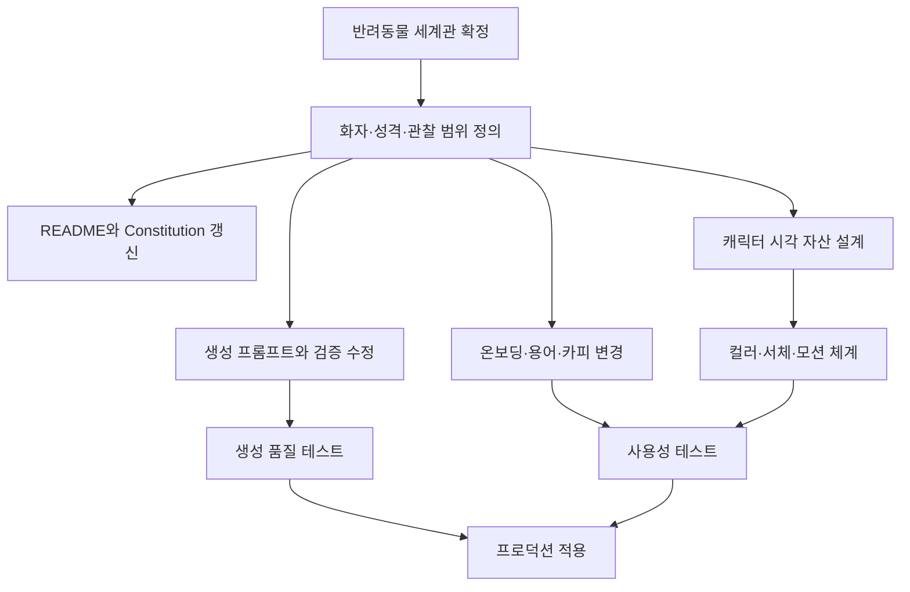
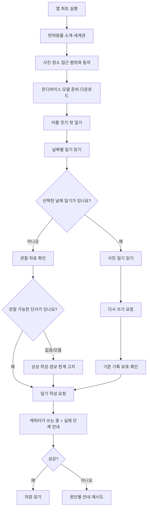
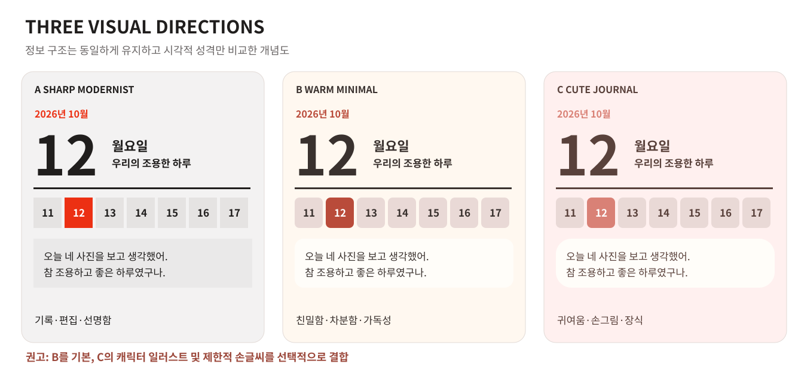
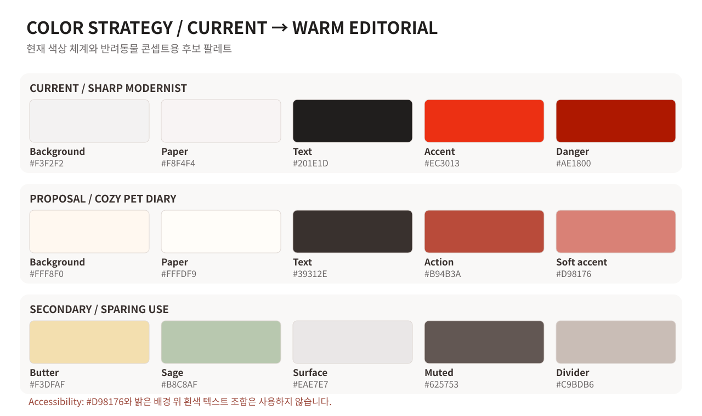
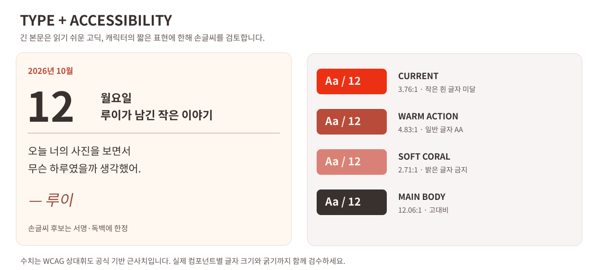
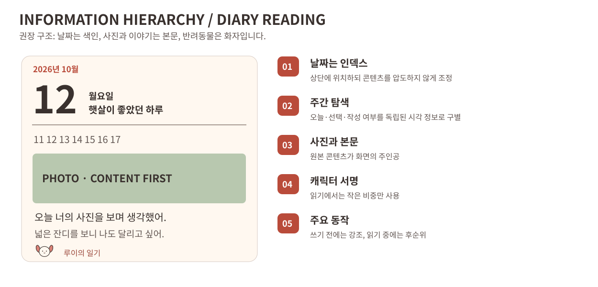
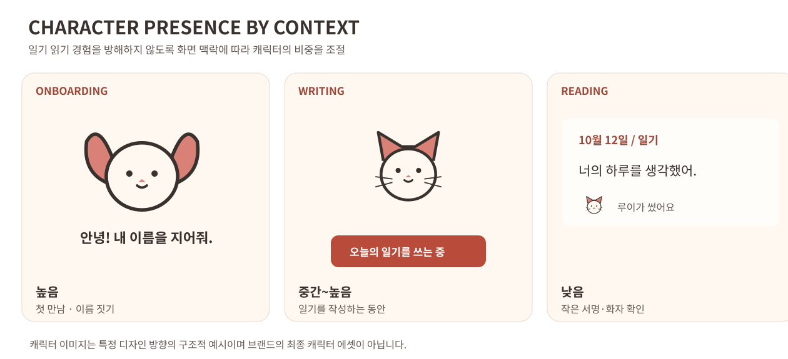

# Pocketlog — 반려동물 관찰 일기 UX·브랜드·비주얼 디자인 종합 검토서

> **문서 목적**: 반려동물이 사용자의 하루를 바라보고 일기를 쓰는 Pocketlog의 제품 콘셉트에 맞춰, 기존 대화에서 논의한 사용성·인지 부하·정보 구조·비주얼 콘셉트·컬러·타이포그래피·캐릭터 시스템·실험 과제·개발 우선순위를 팀이 GitHub에서 검토하고 의사결정할 수 있도록 정리합니다.  
> **검토 기준**: 2026-10-13 · [GitHub 소스 `mrtint/alpharium`](https://github.com/mrtint/alpharium) · 첨부된 화면과 관련 코드에 대한 앞선 검토 내용  
> **문서 상태**: 디자인/UX 검토안 — **확정된 제품 정책 또는 구현 명세가 아닙니다.**  
> **범위 제외**: 앞서 첨부된 **5개 스크린샷 각각의 개별 평가, 날짜별 화면 분석, 화면별 채점**은 의도적으로 포함하지 않습니다. 다만 앱 전반에 공통인 UI 패턴과 시스템 상태에 관한 평가는 포함합니다.

## 목차

1. [가장 중요한 결론과 평가 기준](#1-가장-중요한-결론과-평가-기준)
2. [제품 정의와 현재 구현의 불일치](#2-제품-정의와-현재-구현의-불일치)
3. [경험 설계 원칙과 사용자 멘탈 모델](#3-경험-설계-원칙과-사용자-멘탈-모델)
4. [닐슨의 10가지 휴리스틱 상세 평가](#4-닐슨의-10가지-휴리스틱-상세-평가)
5. [인지 부하 관점의 상세 평가](#5-인지-부하-관점의-상세-평가)
6. [정보 구조·핵심 플로·기능 개선](#6-정보-구조핵심-플로기능-개선)
7. [브랜드·비주얼 콘셉트 평가](#7-브랜드비주얼-콘셉트-평가)
8. [컬러 시스템과 접근성](#8-컬러-시스템과-접근성)
9. [타이포그래피·레이아웃·콘텐츠 표현](#9-타이포그래피레이아웃콘텐츠-표현)
10. [반려동물 캐릭터·일러스트·모션 가이드](#10-반려동물-캐릭터일러스트모션-가이드)
11. [마이크로카피·신뢰·프라이버시](#11-마이크로카피신뢰프라이버시)
12. [개선 과제 우선순위 및 구현 의존성](#12-개선-과제-우선순위-및-구현-의존성)
13. [검증 실험과 성공 기준](#13-검증-실험과-성공-기준)
14. [반대 관점·위험·미결정 사항](#14-반대-관점위험미결정-사항)
15. [결정안과 팀 검토 체크리스트](#15-결정안과-팀-검토-체크리스트)
16. [소스 파일·시각 자료 색인](#16-소스-파일시각-자료-색인)

---

## 1. 가장 중요한 결론과 평가 기준

### 1.1 최종 제품 콘셉트

**Pocketlog는 휴대폰이 일기를 쓰는 앱이 아니라, 강아지·고양이와 같은 반려동물 캐릭터가 사용자의 하루를 자기 시선으로 바라보고 이야기하는 앱입니다.** 휴대폰은 사진·사진의 위치 같은 관찰 가능한 단서를 제공하는 **데이터 수집 수단**이며, 사용자에게 정서적으로 인식되는 **화자는 반려동물**입니다.

제품 경험을 한 문장으로 표현하면 다음과 같습니다.

> **“오늘 내 하루를 우리 작은 친구는 어떻게 바라봤을까?”**

따라서 가장 중요한 가치 제안은 단순한 자동 일기 생성이 아니라 **친밀한 존재의 관점으로 자신의 하루를 다시 읽는 경험**입니다.

### 1.2 디자인 총평

- **유지할 자산**: 단순한 탐색 구조, 날짜별 기록의 명료함, 사진→본문 읽기 흐름, 충분한 여백, 핵심 행동 중심 UI, 공통 디자인 토큰, 설정의 정보 그룹화, 온디바이스 처리라는 제품 차별점.
- **수정할 방향**: 높은 채도의 레드·블랙·직선·초대형 굵은 숫자가 만드는 차갑고 엄격한 인상, 화자가 누구인지 드러나지 않는 UI, 추측과 관찰의 관계를 설명하지 못하는 카피, 반려동물과 사용자 관계의 부재.
- **권장 비주얼 방향**: **Warm & Cozy Minimalism / Cozy Pet Diary**. 따뜻한 크림 바탕 + 절제된 코럴 + 웜 차콜 + 제한적 파스텔 + 일관된 캐릭터 그래픽 + 서명·짧은 독백에 한정한 손글씨. 이는 ‘꾸밈 많은 귀여운 앱’과 다릅니다.
- **우선해야 할 UX 위험**: 캐릭터 세계관과 생성 결과의 불일치, 덮어쓰기 후 이전 기록 복구, 실패 원인·다음 행동의 전달, 일기 미생성 원인, 온디바이스 기록 내보내기·백업.

### 1.3 원칙: ‘잘 만든 UI’와 ‘올바른 브랜드 UI’를 구분

현재 모더니스트 UI가 시각적으로 정돈되어 있다는 평가와, 그 디자인이 반려동물 콘셉트에 적합하다는 평가는 별개입니다. 처음에 **휴대폰 화자**라고 가정했을 때는 기계적·기록물적 에디토리얼 스타일을 정당화할 수 있었지만, **반려동물 화자**가 최종 정의라면 그 논거는 폐기해야 합니다. 기존의 정확한 기능적 장점은 유지하되 컬러·타입·형태·캐릭터 노출은 재평가합니다.

**주의**: 본 문서의 평가와 수치는 **전문가 휴리스틱 리뷰 및 설계 가설**입니다. 실제 사용자의 SUS, 성공률, 체류시간, 만족도를 측정한 결과가 아닙니다. 또한 소스 검토만으로 iOS/Android 모든 실기기 동작을 보장하지 않습니다.

---

## 2. 제품 정의와 현재 구현의 불일치

### 2.1 확인한 현행 구현

다음은 저장소 파일에서 직접 확인한 사실입니다. 문서의 `현재 구현` 표기는 검토 시점의 소스를 의미하며, 새로운 기획 의도가 구현되었다는 뜻은 아닙니다.

| 영역 | 실제 코드/문서에서 확인한 내용 | 반려동물 콘셉트와의 관계 |
|---|---|---|
| 제품 소개 | [`README.md`](https://github.com/mrtint/alpharium/blob/main/README.md)는 **“주인의 휴대폰이 화자가 되어”** 일기를 쓴다고 정의 | 최종 제품 정의와 **충돌** |
| 최상위 원칙 | [`.specify/memory/constitution.md`](https://github.com/mrtint/alpharium/blob/main/.specify/memory/constitution.md) 원칙 II는 **화자가 휴대폰**이라고 규정 | 프로젝트 수준에서 **충돌** |
| 생성 프롬프트 | [`src/diary/prompt.ts`](https://github.com/mrtint/alpharium/blob/main/src/diary/prompt.ts)는 `너는 주인의 휴대폰이다`와 `주머니나 가방 속` 같은 화자 규칙을 사용 | 결과 텍스트와 세계관 **충돌** |
| 첫 만남 | [`src/i18n/catalogs/ko/welcome.ts`](https://github.com/mrtint/alpharium/blob/main/src/i18n/catalogs/ko/welcome.ts)는 얼굴로 `🤖`를 사용하고 휴대폰 안에서 일기가 작성된다고 소개 | 반려동물 첫인상과 **충돌** |
| 캐릭터 | [`src/diary/persona.ts`](https://github.com/mrtint/alpharium/blob/main/src/diary/persona.ts)는 이름과 글쓰기 성향을 관리하며, 이름 사용자 변경을 지원 | 기반 구조 존재. **동물 종·외형과 성격 연결은 별도 설계** |
| 생성 파이프라인 | 온디바이스 추론, 사진 내용 분석, 신호 기반 생성 구조가 존재 | 데이터 파이프라인은 **재사용 가능** |
| 자동 일기 | [`src/schedule/auto-write.ts`](https://github.com/mrtint/alpharium/blob/main/src/schedule/auto-write.ts)에서 자동 생성/건너뜀 판정 | 기능은 유지 가능, **사용자 설명 변경 필요** |
| 일기 저장 | [`src/diary/store.ts`](https://github.com/mrtint/alpharium/blob/main/src/diary/store.ts)는 날짜당 한 일기를 저장하며 덮어쓰기를 지원 | 사용자 기록 보호 정책과 연계 필요 |

**기술적 사실**: 모델이 읽는 입력은 사진·사진 위치 등 디바이스에서 얻은 단서입니다. **세계관적 표현**: 그 단서를 바탕으로 반려동물이 나의 하루를 궁금해하고 이야기합니다. 둘을 혼동하면 관찰하지 않은 일을 실제로 함께 경험했다고 단정하는 문제가 생깁니다.

### 2.2 수정해야 하는 것은 CSS만이 아닙니다

필요한 변경의 의존성은 다음과 같습니다.



프롬프트를 바꾸지 않고 UI만 반려동물처럼 보이게 만들면 **화면과 실제 일기 문장 사이에 모순**이 남습니다. 반대로 프롬프트만 바꾸고 화면을 유지하면 **브랜드 차별화가 드러나지 않을 수 있습니다.** 두 작업은 함께 설계해야 하지만, 순서는 세계관 정의가 먼저입니다.

### 2.3 반드시 합의할 세계관 변수

| 선택지 | 사용자가 이해할 이야기 | 장점 | 위험 |
|---|---|---|---|
| 실제 반려동물 재현 | 내 강아지·고양이가 내 하루를 이야기함 | 애착 형성 가능성 큼 | 실제 반려동물의 행동·성격을 임의로 단정할 위험 |
| 가상 반려동물 | 앱 안에서 만난 친구가 기록을 읽고 이야기함 | 캐릭터 IP와 제품 일관성 확보 쉬움 | 실물 반려동물 애착을 기대한 사용자는 거리감 |
| 가상의 동행형 친구 | 반려동물처럼 내 하루를 함께 바라보는 상징적 존재 | 친밀함과 데이터 한계를 절충 | 실제 동행인지 사진 기반 상상인지 설명 필요 |

**현재 설명만으로 이 세 가지 중 어느 것이 확정인지 알 수 없습니다.** 캐릭터 이미지나 ‘반려동물 사진 등록’ 기능의 필수 여부를 먼저 결정하지 말고 세계관을 확정해야 합니다.

---

## 3. 경험 설계 원칙과 사용자 멘탈 모델

### 3.1 핵심 멘탈 모델

사용자가 받아들이는 과정은 `사진 분석 → AI 생성`이라는 기술 프로세스가 아니라 다음에 가까워야 합니다.

1. **내 친구가 있다**: 이름과 성격을 가진 강아지·고양이 등의 존재.
2. **그 친구가 내 하루의 단서를 본다**: 사진과 장소는 하루 전체가 아니라 단편적 관찰 자료.
3. **그 친구가 자기 마음으로 쓴다**: 관찰 사실과 상상·감상을 구별하면서도 개성을 담은 일기.
4. **나는 다른 시선으로 하루를 다시 읽는다**: 읽는 경험이 사용자 가치를 완성.
5. **기록은 내 것이다**: 로컬 저장, 재생성, 백업, 삭제의 결과를 예측하고 통제할 수 있음.

### 3.2 UX 원칙 7개

| 원칙 | 구현 의미 | 하지 말아야 할 일 |
|---|---|---|
| **화자는 반려동물** | 일기 제목·본문·온보딩·상태 문구에서 동일한 존재감 유지 | 화면은 반려동물, 생성 글은 휴대폰이라고 자기소개 |
| **관찰과 추측은 구분** | 본 사진과 추측한 경험의 경계 명시 | 사진 없이 사용자의 행동을 사실처럼 단정 |
| **읽기가 주인공** | 일기 본문과 사용자의 사진을 최상위 콘텐츠로 취급 | 모든 문단을 아이콘·장식·카드로 감싸기 |
| **친밀함은 과하지 않게** | 작은 서명, 표정, 짧은 말투를 활용 | 매번 등장하는 과도한 캐릭터 애니메이션 |
| **시스템 상태는 솔직하게** | 쓸 수 있음, 생성 중, 실패, 건너뜀을 명확히 구분 | 정확하지 않은 생성 완료 시각이나 가짜 진행률 제공 |
| **기록을 안전하게** | 덮어쓰기 전 확인, 이전 버전 복구/내보내기 | 추억이 담긴 기존 일기를 복구 없이 덮어쓰기 |
| **가벼운 조작** | 기본 행동을 쉽게, 고급 옵션은 설정 하위로 이동 | 캐릭터를 위한 과도한 육성·꾸미기·대시보드 기능 추가 |

### 3.3 사용자에게 가장 먼저 답해야 하는 질문

- **누가** 일기를 쓰나요? → 반려동물 캐릭터입니다.
- **무엇을** 알고 쓰나요? → 사용자가 허용한 사진·사진 위치 등 **관찰 가능한 단서**입니다.
- **실제로 나를 항상 지켜보나요?** → 아니요. 실제 하루 전체를 아는 것이 아니라 확보한 단서로 일부를 짐작합니다.
- **왜 오늘은 일기가 없나요?** → 자동 작성 설정/권한/재료/실행 상태에 따라 달라질 수 있습니다.
- **다시 쓰면 어떻게 되나요?** → 같은 날짜의 기존 일기가 교체되는지, 이전 버전 복구가 가능한지 명확히 알려야 합니다.
- **휴대폰을 바꾸면 기록은 어떻게 되나요?** → 로컬 데이터 보존·내보내기 정책이 필요합니다.

---

## 4. 닐슨의 10가지 휴리스틱 상세 평가

아래는 초기 전문가 리뷰의 구조를 유지하되 **화자를 반려동물로 정정한 평가**입니다. 점수 대신 `강점 / 부분 충족 / 주요 위험`으로 표시했습니다. 우선순위는 화면의 예쁨이 아니라 **발생 시 피해, 이해 실패 가능성, 복구 난이도**를 기준으로 매겼습니다.

| 기준 | 현재의 강점 또는 실제 구현 | 핵심 부족점 | 심각도 |
|---|---|---|---|
| H1 상태 가시성 | 작성 전/중/후와 실패 표시는 구현 | 오래 걸리는 생성·자동 건너뜀 이유 설명이 제한적 | 높음 |
| H2 현실과의 일치 | 사진과 날짜를 중심으로 하루를 재현 | 반려동물 세계관 vs 휴대폰 화자 프롬프트 충돌 | **매우 높음** |
| H3 통제와 자유 | 날짜 이동, 생성 중단, 덮어쓰기 확인 | 복구 버전·내보내기 통제권 부족 | **매우 높음** |
| H4 일관성·표준 | 컬러 토큰·반복 컴포넌트·상태 구분 | 시각 스타일·카피·캐릭터 세계관의 의미 불일치 | 높음 |
| H5 오류 예방 | 재료 없음 확인, 덮어쓰기 전 확인 | 확정 버튼의 결과 예고·영구 손실 방어 미흡 | 높음 |
| H6 회상보다 재인 | 주간 스트립·캘린더·일기 여부 표시 | 날짜 점/오늘 밑줄/큰 날짜 클릭의 의미 학습 필요 | 중간 |
| H7 유연성·효율성 | 주 단위 스와이프, 월·연도 달력 이동 | 오래된 일기 재방문·빠른 오늘 복귀의 최적화 여지 | 중간 |
| H8 미학·미니멀리즘 | 콘텐츠 중심, 불필요한 탐색 탭 적음 | 시각적 완성도와 반려동물 정서의 간극 | 높음(브랜드) |
| H9 오류 진단·복구 | 실패 토스트·권한 안내 존재 | 실패 원인별 다음 행동이 약함 | 높음 |
| H10 도움말·안내 | 첫 실행·권한·이름 짓기 흐름 구현 | 세계관·데이터 한계·보존 방법의 상시 확인 경로 부족 | 중간 |

### H1. 시스템 상태의 가시성 — 부분 충족

**확인 사실**: 미작성일 때의 `일기 쓰기`, 작성 중 상태, `그만두기`, 저장된 날의 `다시 쓰기`, 생성 실패 토스트 등이 구현되어 있습니다. 자동 작성 목표 시각은 정확한 한 시각이 아닌 **지정 시각부터 약 3시간의 판정 구간**을 사용합니다([`src/schedule/decision.ts`](https://github.com/mrtint/alpharium/blob/main/src/schedule/decision.ts)).

**문제**: 모델 생성은 수십 초 이상 지속할 수 있는데, 귀여운 독백만으로는 실제 진행 중인지 멈춘 것인지 알 수 없습니다. 자동 생성이 건너뛰어진 경우도 사용자 입장에서는 ‘앱이 고장 났다’고 인식할 수 있습니다.

**권고**: 캐릭터의 독백은 유지하되 시스템 이벤트에 대응하는 최소한의 단계(`사진을 살펴봐요` → `이야기를 쓰고 있어요` → `저장하고 있어요`)를 제공합니다. 실제 수행 단계가 아닌 퍼센트나 예상 시간을 꾸며내지 않습니다. 자동 작성 건너뜀은 적절한 맥락에서 이유와 해결 행동을 알려줍니다.

### H2. 시스템과 현실의 일치 — 최우선 변경

**문제**: 실제 제품 콘셉트는 반려동물인데, 현재 프롬프트와 헌법은 휴대폰을 화자로 규정합니다. 사용자가 화면에서 기대한 정체성이 생성 일기에 나오지 않을 수 있습니다.

**권고**: 첫 만남, 이름 짓기, 작성 중 독백, 일기 본문, 알림까지 일관된 화자를 사용합니다. 다만 반려동물이 사용자의 실제 모든 행동을 목격한 것처럼 말하지 않도록 **관찰 자료의 한계**를 세계관에 포함합니다.

### H3. 사용자 통제와 자유 — 우선 변경

**확인 사실**: 한 날짜에 하나의 일기를 저장하는 구조이며, 덮어쓰기 전 확인이 있고 새 생성이 실패하면 기존 일기를 유지합니다.

**문제**: 성공적으로 다시 쓰면 이전 결과를 쉽게 되돌리는 사용자 기능은 검토한 구현에서 확인되지 않았습니다. 개인 기록은 교체 비용이 높은 자산입니다.

**권고**: 우선 **날짜별 직전 버전 1개 복구**를 검토하고, 기록 **내보내기** 경로를 제공해야 합니다. 무제한 버전 관리는 저장비용·복잡도를 고려하여 후순위로 둡니다.

### H4. 일관성과 표준 — 시각적 일관성은 강점, 개념적 일관성은 취약

현재 단일 컬러 토큰, 반복되는 헤더·구분선·버튼 구조는 강점입니다. 그러나 캐릭터 이름은 친밀한 친구처럼 사용하면서 시각 요소는 엄격한 기록 UI이고 프롬프트는 휴대폰으로 서술한다면 **세 종류의 의미 체계가 동시에 존재**합니다.

**권고**: 컴포넌트 재사용을 유지하면서 세계관·카피·색상 의미까지 같은 디자인 시스템에서 관리합니다.

### H5. 오류 예방 — 구현된 방어는 유지하고 행동 결과를 명확히

**확인 사실**: 덮어쓰기 확인, 재료 없는 날 확인, 사진 권한 요청·설정 안내가 구현되어 있습니다.

**권고**: `확인`처럼 결과가 모호한 확정 버튼은 필요 시 `상상해서 쓰기`로 명확히 변경합니다. 복구 불가능한 삭제·교체는 실행 결과와 보존 여부를 미리 알려야 합니다. 기존 보호 로직을 버리고 새로운 확인창을 중첩하지 않습니다.

### H6. 기억보다 인식 — 학습이 필요한 미세 표시

현재 주간 날짜의 **선택된 날(배경색)**, **오늘(밑줄)**, **기록이 있는 날(작은 점)**은 구분되어 있습니다. 코드는 각 의미를 일관되게 처리하지만 첫 사용자는 작은 점의 뜻을 추론해야 합니다. 큰 날짜를 누르면 달력이 열린다는 조작도 화면에서 바로 드러나지 않습니다.

**권고**: 첫 사용에 한 번만 짧게 안내하거나, 큰 날짜 옆에 미세한 달력 affordance를 추가합니다. 주간 날짜 각각에 설명 문구를 덧붙여 오히려 복잡하게 만들지 않습니다.

### H7. 유연성과 효율성 — 기본 탐색은 충분, 오래된 기록은 과제

**확인 사실**: 7일 단위 좌우 스와이프와 직접 날짜 이동·월·연도 이동 UI가 구현되어 있습니다. 없는 기능이라고 판단하면 안 됩니다.

**권고**: 과거로 이동했을 때에만 `오늘로` 빠른 이동을 제공하고, 기록 누적 이후에는 날짜를 모르더라도 찾을 수 있는 **월별 보기/제목 검색**을 사용자 테스트로 판단합니다. 사용 초기부터 검색 탭을 강제로 추가할 필요는 없습니다.

### H8. 심미성과 미니멀리즘 — 정보 절제는 유지, 시각 언어는 재설계

UI가 간단하다는 것 자체는 장점입니다. 그러나 **미니멀함=차가운 디자인**은 아닙니다. 반려동물의 친밀감에 더 적합한 크림·웜 차콜·코럴·손그림을 사용하면서도 정보량과 행동 수는 그대로 유지할 수 있습니다.

**권고**: 현대적인 읽기 레이아웃은 유지하고 고대비 레드, 강한 각진 형태, 초대형 무게 중심을 조정합니다. 마스코트를 화면 전체에 반복하지 않습니다.

### H9. 오류를 인식하고 진단하고 복구하도록 지원 — 개선 필요

**확인 사실**: 생성 실패 시 사용자에게 `일기를 쓰지 못했어요.`라는 공통 토스트를 표시하는 경로가 존재합니다.

**문제**: 모델 준비 실패, 권한 문제, 저장 공간 부족, 기타 생성 오류는 복구 방법이 다릅니다.

**권고**: 원인별 설명과 `다시 시도`, `설정 열기`, `저장 공간 확인` 같은 적절한 CTA를 제공합니다. 실패 원인을 확정하지 못했다면 확정적인 진단 문구를 쓰지 않습니다.

### H10. 도움말과 문서 — 온보딩은 존재, 설명의 지속성이 부족

**확인 사실**: 권한→모듈 준비→이름 짓기→첫 일기로 이어지는 첫 실행 흐름이 존재합니다.

**권고**: 설정 하위에 `친구가 일기를 쓰는 방법`, `어떤 사진을 보나요?`, `기록 보관 및 복원` 같은 **짧은 설명 페이지**를 마련합니다. 홈에 항상 긴 도움말을 노출하지 않습니다.

---

## 5. 인지 부하 관점의 상세 평가

### 5.1 이 앱에서 인지 부하가 발생하는 지점

반려동물 일기라는 새로운 개념을 사용자는 아래 두 층으로 해석해야 합니다.

- **정서적 모델**: ‘나와 관계를 맺는 반려동물 친구가 내 하루를 이야기한다.’
- **기술적 모델**: ‘사진, 촬영 위치, 권한, 로컬 AI 모델, 자동 작성 조건에 따라 실제로 일기가 만들어진다.’

두 층이 어긋나면 사용자는 ‘강아지가 나를 지켜봤다는데 왜 사진이 없으면 아무것도 모르지?’라고 생각할 수 있습니다. 이 불일치를 설명하는 방식이 UX의 핵심입니다.

### 5.2 내재적 인지 부하(Intrinsic)

사용자가 이해해야 할 개념: 반려동물이 화자, 휴대폰 데이터는 단서, 관찰되지 않은 장면은 상상 가능, 자동/수동 작성 조건이 다름, 기록은 로컬 저장. 이를 제거할 수는 없지만 첫 실행에서 한 번에 기술적으로 모두 설명할 필요도 없습니다.

**권고**: 온보딩은 `친구 소개 → 친구가 볼 수 있는 것 → 이름 짓기 → 첫 일기`의 순서로 이해시키되, 모델 크기·추론 방식 같은 기술 정보는 필요한 단계에서만 제공합니다. 모델 다운로드 약 2GB 등 큰 비용·네트워크 동의는 숨기지 않습니다.

### 5.3 외재적 인지 부하(Extraneous)

UI가 불필요하게 요구하는 추론: 작은 점은 무슨 의미인지, 오늘은 무엇으로 구별되는지, 어떤 날에 `다시 쓰기`가 뜨는지, 왜 자동 작성이 실행되지 않았는지, 왜 같은 색이 선택·오류·사진 배지에 쓰이는지 등입니다.

**권고**: 의미가 겹치는 상태색의 역할을 재정의하고, 조작이 숨겨진 곳에 affordance나 최초 1회 안내를 제공합니다. 반복 정보(캐러셀 점+숫자처럼 의미가 거의 같은 경우)는 실제 이용성 테스트 후 통합합니다.

### 5.4 학습에 기여하는 인지 부하(Germane)

`상상으로 쓴 일기`, `친구가 본 사진`, `일기를 다시 쓰면 기존 결과가 바뀜`처럼 **사용자가 올바른 개념을 형성하는 데 도움이 되는 안내**는 유지할 가치가 있습니다. 이는 불필요한 설명이 아닙니다.

**권고**: 중요한 사실은 `친구의 말투`와 `시스템 안내`를 분리해 제공합니다. 반려동물 독백으로 모든 상태를 숨기면 사용자가 기술적 상황을 잘못 판단할 수 있습니다.

### 5.5 인지 부하 절감 전략

| 상황 | 현재 또는 예상 마찰 | 개선 원칙 | 피해야 할 과잉 대응 |
|---|---|---|---|
| 첫 만남 | 캐릭터 정체성과 AI 처리 과정의 동시 학습 | 세계관을 먼저, 기술 설명은 점진 노출 | 6~8단계 긴 온보딩 |
| 날짜 탐색 | 점·밑줄·선택 상태를 외워야 함 | 최초 사용 가이드·명확한 상태 의미 | 일곱 칸 모두 텍스트 배지 |
| 일기 생성 | 작성 중인지 멈췄는지 불명확 | 실제 단계 + 캐릭터 독백 | 가짜 퍼센트·복잡한 디버그 패널 |
| 기록이 없는 날 | 왜 AI가 일기를 쓸 수 있는지 의문 | 관찰 자료 없음/상상 작성 분리 | 공포·경고 스타일의 빨간 배너 |
| 기록 읽기 | 캐릭터가 화자라는 사실을 잊음 | 작은 서명 또는 관계형 카피 | 모든 문장 옆 캐릭터 아이콘 |
| 자동 작성 실패 | 왜 누락되었는지 모름 | 맥락 있는 실패 이유·다음 행동 | 설정 항목을 홈에 대량 노출 |
| 데이터 교체 | 재생성·삭제 결과 예측 어려움 | 직전 결과 보호·확정 동작 예고 | 확인창을 여러 번 중첩 |

---

## 6. 정보 구조·핵심 플로·기능 개선

### 6.1 정보 구조의 권장 원칙

Pocketlog는 **콘텐츠 중심의 단일 날짜 인터페이스**를 유지하는 것이 적절합니다. 홈에 여러 탭과 카드, 캐릭터 육성 메뉴를 추가하는 것은 기본 제품 가치를 분산시킬 수 있습니다.

권장 정보 우선순위는 다음과 같습니다.

1. 현재 선택한 날짜와 기록 유무
2. 그날 반려동물이 작성한 일기와 참고 사진
3. 미작성·작성 중·실패 등 현재 상태
4. 맥락에 맞는 주요 행동(`일기 부탁하기`, `다시 쓰기` 등)
5. 캐릭터의 정체성을 알려주는 최소한의 시각·문자적 단서
6. 설정, 권한, 백업, 고급 관리 기능

### 6.2 주요 사용자 플로



### 6.3 상태 설계 계약(권고)

| 상태 | UI의 핵심 메시지 | 주요 조작 | 캐릭터 존재감 |
|---|---|---|---|
| 첫 만남 | 이 친구가 누구인지, 무엇을 하는지 | 이름 짓기·시작 | 높음 |
| 미작성·자료 있음 | 친구가 이 날의 단서를 볼 수 있음 | 일기 부탁하기 | 중간 |
| 미작성·자료 없음 | 관찰 자료가 없고 상상 작성이 됨 | 상상해서 쓰기 | 중간 |
| 미작성·권한 제한 | 볼 수 있는 단서가 제한됨 | 설정 열기·허용 범위 이해 | 중간 이하 |
| 작성 중 | 친구가 일기를 만드는 중 + 실제 실행 단계 | 그만두기 | 중간~높음 |
| 작성 완료 | 사진과 이야기, 작은 화자 서명 | 읽기·필요 시 다시 쓰기 | 낮음 |
| 재작성 확인 | 기존 결과가 교체됨을 안내 | 다시 쓰기/취소 | 낮음 |
| 실패 | 실패한 사실과 재시도 또는 해결 방법 | 상황별 CTA | 낮음 |
| 데이터 삭제 | 무엇이 영구 삭제되는지 정확히 안내 | 삭제/취소 | 매우 낮음 |

**중요**: 상태 설계의 이름이 `상상해서 쓰기`라고 해서 앱 전역의 모든 CTA를 날짜 상황마다 바꾸자는 뜻은 아닙니다. 기본 `일기 쓰기`를 유지하고 확인 대화상자에서만 정확한 결과를 예고하는 대안도 유효합니다.

### 6.4 기능과 정보 개선안

| 과제 | 근거 | 권장 수준 | 범위 확장 시 주의 |
|---|---|---|---|
| 재작성 직전 버전 복구 | 개인 기록의 교체 손실 | 출시 핵심(P0) | 무제한 이력은 후순위 |
| 기록 내보내기·백업 | 온디바이스 기록의 데이터 소유권 | 우선(P1) | 서버 동기화로 바로 확대하지 않음 |
| 오류별 복구 CTA | 원인마다 해결 방법이 다름 | 우선(P1) | 모르는 원인은 단정하지 않음 |
| 캐릭터 정체성 재안내 | 화자에 대한 멘탈 모델 | 우선(P1) | 홈의 상시 장황한 설명 금지 |
| 자동 작성 건너뜀 안내 | 예약한 작성이 안 된 이유 이해 | 우선(P1) | 모든 내부 상태를 노출하지 않음 |
| 빠른 ‘오늘’ 이동 | 과거 탐색 후 복귀 | 개선(P2) | 기본 헤더에 불필요한 상시 버튼 금지 |
| 월별 모아보기·검색 | 날짜를 기억하지 못하는 회고 | 실사용 후(P2) | 별도 대시보드로 커지지 않게 |
| 월간 회고 | 장기 사용 동기 | 후보(P3) | 초기 가치 검증 없이 정기 기능화 금지 |
| 강아지·고양이 캐릭터 확대 | 친밀감·차별화 | 세계관 확정 후 | 종만 바꾸고 문체 동일하면 효과 약함 |

---

## 7. 브랜드·비주얼 콘셉트 평가

### 7.1 현재 스타일의 정확한 해석

현행 디자인은 `Swiss/International Typography + Editorial + Archival` 성격을 결합합니다.

- **Swiss/Modernist**: 선명한 색상, 직선, 대형 숫자, 강한 고딕, 규칙적인 날짜 배열.
- **Editorial**: 사진 뒤에 긴 본문을 자연스럽게 읽게 하는 인쇄물 같은 정보 구조.
- **Archival**: 날짜·기록 존재·일기 상태를 정돈된 인덱스로 표현.

**강점**: 세련된 일관성, 콘텐츠 집중, 화면 구성의 확장성, 높은 시각적 명료함.

**한계**: 강아지·고양이 같은 정서적 화자의 존재를 표현하는 데 약합니다. 제품명을 가리면 일반적인 미니멀 저널과 구별하기 어려울 수 있습니다.

### 7.2 초기 평가에서 철회·수정하는 부분

| 초기의 근거 | 최종 판단 |
|---|---|
| “휴대폰의 기계적 관찰과 샤프한 모더니즘이 잘 맞는다” | **철회**. 화자는 반려동물이므로 기계적 분위기를 정당화하는 핵심 이유로 사용할 수 없음 |
| “현재 레드와 강한 글자 중심을 거의 그대로 유지한다” | **수정**. 강한 색채·굵은 숫자 조합을 Warm/Cozy 대안과 비교해야 함 |
| “캐릭터는 작은 서명만 있으면 된다” | **조건부**. 일기 **읽기**에서는 작은 서명이 좋지만 첫 만남·작성 중·빈 상태에서는 더 큰 존재감 필요 |
| “따뜻한 감성 UI는 흔해지기 쉽다” | **여전히 유효**. 귀여움 과잉·파스텔 남용에 주의 |
| “읽기 중심 미니멀 구조는 유지” | **유지**. 정보를 적게 보여주는 것과 차갑게 디자인하는 것은 다름 |

### 7.3 디자인 방향 3종 비교



| 방향 | 시각 요소 | 장점 | 반대 관점 | 결론 |
|---|---|---|---|---|
| A. Sharp Modernist | 레드·블랙, 직선, 초대형 숫자 | 강한 그래픽 개성·기존 구현 유지 | 반려동물 콘셉트가 약함 | 현재 기준안 |
| **B. Warm & Cozy Minimalism** | 크림, 코럴, 부드러운 형태, 간결한 캐릭터 | 친밀감·가독성·성인 대상 일기 균형 | 다소 평범해질 위험 | **최우선 검증안** |
| C. Cute Hand-drawn Diary | 파스텔, 손글씨, 스티커, 손그림 | 귀여움·캐릭터 IP 강조 | 유아용·육성 게임처럼 보일 위험 | 요소만 선별 차용 |

권고 방향은 **B를 기본으로 C의 손그림·서명 표현을 부분 차용**하는 것입니다. ‘친근함을 높인다’는 명목으로 모든 화면을 장식하지 않습니다.

### 7.4 디자인 북극성(North Star)

> **Cozy Pet Diary — 나의 하루를 바라보는 작은 친구의 일기**  
> 기능은 단정하게, 분위기는 따뜻하게, 글은 자연스럽게, 캐릭터는 관계가 필요한 순간에 보이게.

브랜드 형용사를 정리하면 다음과 같습니다.

- **추구**: 다정한, 사적인, 장난기 있는, 편안한, 호기심 있는, 읽기 좋은, 절제된.
- **지양**: 공격적인, 차가운, 의료·데이터 대시보드 같은, 과하게 유아적인, 게임화된, 불필요하게 장식적인.

### 7.5 반려동물 콘셉트라면 전부 파스텔이어야 하는가?

아닙니다. 귀여움과 미니멀리즘은 양립 가능합니다. 따뜻한 디자인은 **저채도 색상 + 글자 선택 + 형태 + 캐릭터 + 언어**의 합성 결과입니다. 컬러만 연하게 바꾼다고 반려동물의 관계성이 자동으로 생기지는 않습니다. 반대로 현재의 강한 레드도 활발한 캐릭터와 결합하면 잘 맞을 수 있습니다. 그래서 **동일 화면, 동일 카피, 동일 캐릭터를 두고 디자인만 바꾸는 비교**가 필요합니다.

---

## 8. 컬러 시스템과 접근성

### 8.1 실제 현행 컬러와 권장 대안



**현재 구현값**([`src/ui/theme/tokens.ts`](https://github.com/mrtint/alpharium/blob/main/src/ui/theme/tokens.ts)):

| 역할 | HEX | 해석·평가 |
|---|---|---|
| `bg` | `#F3F2F2` | 차분한 오프화이트. 유지 가능한 자산 |
| `paper` | `#F8F4F4` | 미세하게 따뜻한 지면. 유지 가능 |
| `surface` | `#EAE9E9` | 중립적인 보조 면 |
| `text` | `#201E1D` | 짙은 잉크 색. 가독성 좋음 |
| `textMuted` | `#6B6767` | 중간 회색. 본문보다 낮은 위계 |
| `accent` | `#EC3013` | 높은 채도의 웜 레드. 강한 행동·선택 강조 |
| `danger` | `#AE1800` | 위험·삭제 등 별도 진한 레드 |
| `border` | `#9F9D9D` | 규칙적 구분선 |
| `rewriteBar` | `#EAE7E7` | 보조 행동의 중성 배경 |

**Warm/Cozy 비교용 제안값(아직 확정 아님)**:

| 역할 | HEX | 사용 지침 |
|---|---|---|
| 기본 배경 / Warm Cream | `#FFF8F0` | 전체 바탕, 따뜻함의 기반 |
| 일기 지면 / Paper White | `#FFFDF9` | 사진·긴 본문이 놓이는 면 |
| 본문 / Warm Charcoal | `#39312E` | 긴 글·날짜·설정 라벨 |
| 주요 행동 / Warm Coral Red | `#B94B3A` | CTA·선택 상태·중요한 강조. **일반 밝은 글자 대비 검증** |
| 부드러운 코럴 / Soft Coral | `#D98176` | 장식적 영역·캐릭터 자산. 작은 밝은 글자의 배경으로 사용 금지 |
| 버터 / Butter Yellow | `#F3DFAF` | 캐릭터·일러스트 보조색 |
| 세이지 / Sage Green | `#B8C8AF` | 캐릭터·소규모 보조 영역 |
| 보조 배경 / Warm Surface | `#EAE7E7` | 태그·보조 카드·구분 |
| 보조 글자 | `#625753` | 캡션·일자·메타데이터 |

**대조 실험에 포함할 중간 후보**: `#D66B5D`(Soft Coral 계열). 현재 레드와 Warm Coral 사이의 인상을 비교할 수 있지만, 작은 흰 글자의 배경으로 쓰기에는 대비가 부족하므로 최종 색상 결정 전 컴포넌트 검수가 필요합니다.

### 8.2 컬러 역할을 구분해야 하는 이유

현재 브랜드 레드가 **선택일, 주요 CTA, 사진 순번, 장식 라벨, 상태 표시**까지 폭넓게 사용됩니다. 이로 인해 '빨간색=중요함'이라는 규칙 외에 구체적인 의미를 배우기 어렵습니다.

**권장 의미 체계**:

| 역할 | 기본 지침 | 피해야 할 조합 |
|---|---|---|
| Primary Action | 전 화면에서 동일한 주요 행동 스타일 | 같은 레드로 수십 개의 행동 강조 |
| Selected | 선택된 날짜/옵션만 강하게 표시 | 오류·위험과 선택을 같은 표식만으로 구별 |
| Passive Metadata | 중성색 우선 | 사진 순번·보조 통계를 Primary만큼 강하게 표시 |
| Character Accent | 아이콘, 이름표, 얼굴 주변의 제한적 색 | 동물 종류마다 전 화면 테마 자동 변경 |
| Destructive | 충분한 대비 + ‘삭제’ 등 명시적 단어 | 일반 브랜드 행동과 구별 불가능한 버튼 |
| Uncertain/Imagined | 중립적 안내 + 명확한 문구 | 상상 일기를 위험/오류처럼 붉은 경고로 표시 |

### 8.3 실제 색상 대비 검증



아래는 WCAG 상대휘도 공식으로 계산한 **근사 대비비**입니다. 가독성은 대비비 외에도 글자 크기·굵기·실제 사용 환경에 영향을 받습니다.

| 전경 ↔ 배경 | 대비비 | 일반 텍스트 WCAG AA 4.5:1 | 판단 |
|---|---:|---|---|
| 현행 `#F3F2F2` ↔ `#EC3013` | **3.76:1** | 미달 | 작은 흰색 글자에 사용 금지 |
| 현행 `#6B6767` ↔ `#F3F2F2` | **5.00:1** | 충족 | 보조 본문 활용 가능 |
| 제안 `#FFF8F0` ↔ `#B94B3A` | **4.83:1** | 충족 | 일반 글자 대비 기준 통과 |
| 제안 `#FFF8F0` ↔ `#D98176` | **2.71:1** | 미달 | 작은 밝은 텍스트 배경 금지 |
| 제안 `#FFF8F0` ↔ `#39312E` | **12.06:1** | 충족 | 본문에 적절 |
| 제안 `#FFF8F0` ↔ `#625753` | **6.63:1** | 충족 | 캡션에 적절 |

일반 텍스트와 UI 구성 요소는 판정 기준이 다릅니다. 일반 크기 텍스트 4.5:1, 큰 글자 또는 굵은 큰 글자 3:1, 핵심 UI 경계 및 상태 정보 3:1 등을 각각 확인해야 합니다. 색상만으로 상태를 구분하지 않는 원칙도 적용합니다.

### 8.4 컬러 채택 결정

최종 채택 전에 동일한 정보 구조의 프로토타입에 최소한 다음 세 대안을 적용합니다.

- A1: 현재 `#EC3013` 중심 체계(현행 기준).
- B1: `#B94B3A` 중심 Warm/Cozy 체계(우선 비교안).
- B2: 현재 레드는 CTA에 유지하되 크림 배경·웜 차콜·캐릭터 그래픽만 변경하는 혼합안.

**반대 관점**: 브랜드 레드를 너무 부드럽게 만들면 강한 시각적 식별력을 잃을 수 있습니다. 그래서 레드 변경을 확정 사항이 아니라 **검증할 가설**로 둡니다.

---

## 9. 타이포그래피·레이아웃·콘텐츠 표현

### 9.1 현재 타이포의 강점과 충돌

현행 값은 대형 날짜 62/800, 요일 16/700, 기록 제목 15/700, 본문 15/행간 1.65, 설정 제목 44/800, CTA 17/800 등을 중심으로 합니다. 날짜를 브랜드의 시각적 앵커로 삼고 본문에 충분한 행간을 준 점은 유효합니다.

그러나 **날짜는 색인이고, 그날의 일기와 반려동물의 시선이 콘텐츠**입니다. 날짜가 지나치게 강하면 콘텐츠보다 기록 관리가 주인공처럼 보일 수 있습니다. 반려동물 콘셉트에서는 너무 굵은 검정 숫자와 엄격한 서체의 조합도 재검토 대상입니다.

| 요소 | 현재 구현 | 새 비교안 | 판단 |
|---|---|---|---|
| 날짜 | 62pt / 800 | 44~48pt의 부드러운 산세리프 또는 52~56pt 절충안 | **A/B 테스트** |
| 요일 | 16pt / 700 | 15~17pt / 600~700 | 큰 변화 불필요 |
| 일기 제목 | 15pt / 700 | 16~18pt / 600~700 | 본문보다 약간 높은 비중 권장 |
| 일기 본문 | 15pt / 행간 1.65 | 기본 유지, 폰트 실기기 검증 | **유지 권장** |
| 주간 요일 | 10pt | 11~12pt | 가독성 개선 |
| 작은 섹션/메타 | 11pt | 12~13pt 검토 | 읽기 가능한 보조 정보 |
| CTA | 17pt / 800 | 16~17pt / 600~700 | 부드러운 성격과 위계 조화 |
| 캐릭터 서명 | 별도 손글씨 체계 없음 | 짧은 이름·독백에 한정하여 손글씨 | **새 역할 신설** |

**주의**: 44~48pt 날짜는 새 디자인 가설입니다. 62pt가 잘못되었다는 실측 결과가 아닙니다. 작은 화면에서 본문의 최초 노출량·헤더 이동 안정성을 함께 비교해야 합니다.

### 9.2 손글씨는 ‘부분 서체’로 사용하는 것이 적절

손글씨는 반려동물이 직접 적어 준 듯한 분위기를 만드는 데 유리합니다. 그러나 전체 본문과 설정을 손글씨로 처리하면 긴 한글 문장의 가독성이 떨어지고 플랫폼·글꼴 확대 대응도 복잡해집니다.

**권장**: 캐릭터 이름, 짧은 독백, 서명, 일부 온보딩 장식에만 손글씨 후보를 적용합니다. **비권장**: 본문 전체, 버튼, 권한, 날짜 스트립, 긴 에러 메시지에 손글씨를 적용하는 것.

폰트 후보는 실제 문장으로 1~2회 비교 테스트한 후 채택합니다. 외부 폰트의 라이선스와 앱 번들 크기, Android/iOS 글리프 표현을 별도 검토해야 합니다.

### 9.3 권장 정보 위계



읽기 경험을 중심에 놓고 날짜·주간 탐색·사진·본문·캐릭터 서명의 위계를 구성합니다. **캐릭터가 주인공인 제품이라고 해서 일기를 읽는 모든 순간 캐릭터 이미지가 가장 커야 한다는 뜻은 아닙니다.**

### 9.4 기존 그리드와 스크롤 구조의 장점

- 좌우 약 20pt의 일관된 여백은 유지할 가치가 있습니다.
- 사용자가 저장된 글을 읽을 때 주간 스트립이 스크롤에 따라 접히는 구현이 존재합니다. ‘주간 스트립이 항상 고정된다’고 오판하지 않습니다.
- 사진 캐러셀은 약 210pt의 고정 높이를 사용합니다. 짧은 화면에서는 사진과 헤더가 첫 화면을 거의 차지할 수 있으므로 180~190pt 대안과 비교합니다.
- 읽을 때는 `다시 쓰기`를 하위 행동으로, 작성 전에는 `일기 쓰기`를 주요 행동으로 강조하는 구조가 타당합니다. 이 **행동 위계는 유지**해야 합니다.
- 기록이 짧거나 없는 날의 여백은 모두 나쁜 것이 아닙니다. 기록 완료 화면의 여백과 작성 전 빈 상태의 안내 부족을 분리해 판단합니다.

### 9.5 미니멀함과 샤프함의 구분

| 개념 | 뜻 | 권장 판단 |
|---|---|---|
| 미니멀함 | 불필요한 정보·행동·장식을 줄이는 구조 | **유지** |
| 샤프함 | 강한 대비, 각진 형태, 높은 글꼴 무게의 시각적 분위기 | **완화 비교** |
| 따뜻함 | 색채·서체·문구·캐릭터가 만드는 친밀한 분위기 | **강화** |
| 귀여움 | 캐릭터 비율, 표정, 움직임, 손그림 디테일 | **절제해서 강화** |

완전히 둥근 카드와 분홍 파스텔, 손글씨로 바꾸는 것이 유일한 정답은 아닙니다. **따뜻하지만 성인이 오래 읽을 수 있는 미니멀함**이 가장 유망한 기본값입니다.

---

## 10. 반려동물 캐릭터·일러스트·모션 가이드

### 10.1 캐릭터는 장식이 아니라 화자입니다

캐릭터를 단지 귀여운 아이콘으로 추가하면 본문과 분리된 그래픽에 그칩니다. 캐릭터의 **종류·성격·호칭·시선·말투·관찰 가능 범위**가 일관되어야 합니다. 실제 구현에서 현재 캐릭터 이름과 스타일 관리는 존재하지만, ‘강아지/고양이’의 종별 성격·일러스트 체계를 최종 확정했다고 볼 근거는 없습니다.

### 10.2 화면 맥락에 따른 캐릭터 노출



| 맥락 | 노출 | 이유 | 유의점 |
|---|---|---|---|
| 첫 만남·작명 | **높음** | 정서적 관계 형성의 시작점 | ‘AI 모델 선택’보다 친구 소개처럼 표현 |
| 일기 작성 전 | **중간** | 사용자가 친구에게 일기를 부탁한다는 경험 | 빈 상태에서 무의미한 반복 멘트 지양 |
| 일기 생성 중 | **중간~높음** | 생성 행위를 캐릭터 행동과 연결 | 실제 작업 단계 안내는 별도 유지 |
| 일기 읽기 | **낮음** | 본문과 사진이 중심 | 작은 얼굴·이름·서명 정도 |
| 설정·권한 | **낮음** | 기능의 정확성 우선 | 캐릭터 때문에 설정 결과가 흐려지지 않도록 |
| 파괴적 오류·삭제 | **최소** | 결과 예측과 안전이 우선 | 캐릭터의 장난스러운 표정으로 심각성을 희석하지 않음 |

### 10.3 캐릭터 스타일 세 방향

1. **단순 기하학 캐릭터**: 균형 잡힌 면·선·제한된 색. 기존 구조와 통합 쉬움. 우선 디자인 후보.
2. **손그림 라인 캐릭터**: 약간 불규칙한 윤곽·손으로 쓴 느낌. 따뜻함과 개성 표현에 유리. 우선 비교 후보.
3. **입체 3D 클레이 캐릭터**: 강한 귀여움·풍부한 표정. 앱을 육성 게임처럼 보이게 할 가능성과 제작·런타임 비용이 큼. 초기 비권장.

**권고**: 캐릭터가 커지는 첫 만남/작성 중 화면은 1·2의 비교 시안, 읽기 화면은 최소한의 이미지/서명 배치를 먼저 검토합니다.

### 10.4 캐릭터의 말투는 디자인 시스템과 연결되어야 합니다

예를 들어 ‘같은 사진을 보고도 강아지는 뛰어보고 싶다고 하고 고양이는 쉬고 싶다고 말하는’ 식의 **성격 차이**는 충분한 가치가 있습니다. 그러나 이 차이는 임의의 의인화가 아니라 실제 검증된 생성 품질과 일관된 인격 설계를 필요로 합니다.

- **가능**: “사진 속 잔디를 보니 나도 뛰어보고 싶어.” — 캐릭터의 생각을 서술.
- **주의**: “오늘 나도 너랑 골프장에 가서 뛰었어.” — 실제 동행 근거가 없으면 사실 오인.
- **가능**: “오늘은 사진이 없네. 네가 어떤 하루를 보냈는지 궁금해.” — 모르는 것을 인정.
- **주의**: “네가 오늘 늦게 집에 온 걸 내가 봤어.” — 데이터를 통해 확인할 수 없다면 단정 금지.

이 규칙은 생성 프롬프트·제목 생성·상상 작성 정책·UI 설명에서 함께 다뤄야 합니다.

### 10.5 모션 원칙

- **목적 있는 움직임**: 첫 만남의 작은 인사, 일기 작성 중의 집중, 완료 시의 짧은 반응.
- **절제**: 작은 반응을 기본으로, 강한 반복 애니메이션·상시 시선 추적·무한한 바운스 금지.
- **사용자 선택 존중**: OS Reduce Motion 설정을 반영하고 애니메이션이 꺼져도 정보가 빠지지 않아야 함.
- **리소스 검증**: 온디바이스 추론과 동시에 실행되므로 메모리·배터리·프레임 저하를 실기기에서 검증.
- **감정 일치**: 일기 내용과 무관한 과도한 기쁨·슬픔 모션은 신뢰를 떨어뜨릴 수 있음.

### 10.6 종별 색상 테마는 초기 필수가 아닙니다

강아지는 노랑, 고양이는 보라처럼 **종류마다 전체 테마를 바꾸는 설계는 초기 비권장**입니다. 브랜드 파편화, 모든 색상 대비의 중복 검수, QA 확대가 발생합니다. 공통 브랜드 팔레트를 유지하고 동물별 차이는 얼굴·목걸이·작은 소품·서명·말투에 국한하는 대안을 권장합니다.

---

## 11. 마이크로카피·신뢰·프라이버시

### 11.1 ‘친구의 목소리’와 ‘시스템의 목소리’를 분리

| 상황 | 반려동물 관점의 카피 후보 | 정확한 시스템 정보 |
|---|---|---|
| 첫 만남 | “안녕! 네 하루를 이야기로 남겨볼게.” | 사진·위치 등 허용한 정보만 사용 |
| 작성 전 | “오늘의 이야기를 내가 적어볼까?” | 일기 작성 시작 버튼 |
| 재료 없음 | “오늘은 내가 본 사진이 없네.” | 확인된 재료가 없으므로 상상으로 생성될 수 있음 |
| 작성 중 | “무슨 이야기를 먼저 적을지 생각하고 있어.” | 현재 실제 처리 단계 표시 |
| 완료 | “오늘의 일기를 다 썼어.” | 저장 완료와 읽을 수 있는 상태 |
| 재작성 | 캐릭터 멘트 없어도 무방 | 기존 일기가 새 글로 교체됨을 명시 |
| 오류 | 장난스러운 감정 표현 최소화 | 오류 사실·다시 시도·설정 안내 |

위 문구는 **검토용 예시**이지 현재 앱 문자열이 아닙니다. 최종 문체(해요체/반말, ‘주인님’ 호칭 여부 등)는 관계 설정과 대상 사용자 검증 뒤 확정해야 합니다.

### 11.2 관찰 사실·추측·상상 표기

현재 구현은 자료가 없는 날을 구별하여 `지어낸 하루`로 표시하는 로직이 있습니다([`src/app/material.ts`](https://github.com/mrtint/alpharium/blob/main/src/app/material.ts), [`src/ui/WrittenDayPaper.tsx`](https://github.com/mrtint/alpharium/blob/main/src/ui/WrittenDayPaper.tsx)). **이 구분은 유지해야 합니다.** 단, 반려동물 콘셉트에서는 ‘시스템이 지어냈다’보다 `상상으로 쓴 일기`처럼 사용자에게 명확하고 부드러운 명칭이 적합할 수 있습니다.

사실과 상상을 혼동시키지 않기 위해 각 문장마다 출처 배지를 붙일 필요는 없습니다. 적어도 **전체 일기의 유형과 한계**를 사용자가 인지하도록 안내하고, 생성 프롬프트에서 관찰하지 않은 사건을 단정하지 않도록 해야 합니다.

### 11.3 휴대폰 데이터와 프라이버시 설명

현재 문서·구현은 온디바이스 생성이라는 제품 원칙을 갖고 있습니다. 다만 사진의 좌표를 사람에게 읽히는 장소명으로 바꾸는 과정에서 `expo-location`의 역지오코딩 기능을 사용할 수 있습니다([`src/signals/geocoding-port.ts`](https://github.com/mrtint/alpharium/blob/main/src/signals/geocoding-port.ts)). 플랫폼의 지도 서비스 이용과 위치 관련 처리 경로는 별도 검증이 필요합니다.

**표현 원칙**: `일기 생성은 기기에서 이루어져요`처럼 검증 가능한 주장을 우선하고, 모든 정보가 어떠한 외부 서비스에도 전송되지 않는다고 포괄적으로 단정하지 않습니다. 네트워크 동작·권한·보관 범위는 실기기와 플랫폼별로 검수한 뒤 문구를 확정합니다.

또한 사진에서 유추하는 장소 수는 사용자의 실제 모든 이동 경로가 아닙니다([`src/signals/places.ts`](https://github.com/mrtint/alpharium/blob/main/src/signals/places.ts)). `다닌 장소 전체`로 오인되지 않도록 설명해야 합니다.

### 11.4 자동 작성과 기대 관리

설정에는 `매일 쓰는 시각`과 `오후 10시쯤` 등의 표현이 있으며 내부 스케줄은 시간 창을 사용합니다. 따라서 `오후 10시 정각에 반드시 작성`된다고 약속해서는 안 됩니다. 권한 거부, 자료 없음, 기기 백그라운드 제약 등에 따른 건너뜀을 사용자에게 설명할 수 있어야 합니다. 적시에 작성하는 것이 보장되는지 여부는 플랫폼별 검증이 필요합니다.

### 11.5 기록 보존은 제품 신뢰 문제

로컬 저장은 프라이버시 강점인 동시에 기기 변경·삭제의 위험을 가집니다. UX 관점에서 `일기 모두 지우기`가 있는 것만큼 **내보내기/백업/이전 결과 복구**의 통제권이 중요합니다. 이 세 기능의 실제 구현 여부는 작업 착수 전 최신 코드에서 다시 확인해야 하며, 본 문서는 검토 당시 확인되지 않은 기능이 있다는 이유로 ‘절대 없음’을 주장하지 않습니다.

---

## 12. 개선 과제 우선순위 및 구현 의존성

P0/P1/P2/P3는 **권고 우선순위**이며, 실제 스프린트 배정은 팀이 결정합니다.

| ID | 과제 | 우선순위 | 근거 | 영향 코드/영역 | 완료 판단 |
|---|---|---|---|---|---|
| C-01 | 제품 세계관 확정 | **P0** | 화자가 일치하지 않으면 모든 화면·글에서 혼란 | 기획·문서·프롬프트 | 팀이 캐릭터 정체성/관찰 범위/호칭 승인 |
| C-02 | 휴대폰 화자 규칙을 반려동물로 수정 | **P0** | README/Constitution/Prompt의 직접 충돌 | `README`, `constitution`, `prompt.ts` | 텍스트·테스트·생성 결과의 화자 일치 |
| U-01 | 재작성 직전 버전 복구 | **P0** | 개인 기록의 비가역적 손실 | 일기 저장·UI | 재생성 성공 뒤 되돌리기 가능 |
| V-01 | Warm/Cozy 시각 방향 2~3종 비교 | **P1** | 캐릭터 콘셉트와 현재 비주얼 간극 | 디자인 토큰·프로토타입 | 동일 조건 비교 시안/평가 기록 |
| V-02 | 캐릭터 아트 디렉션/일러스트 규칙 | **P1** | 가장 중요한 차별점이 보이지 않음 | 에셋·온보딩·작성 화면 | 종·비율·표정·노출 규칙 정의 |
| V-03 | 작은 레드/코럴 텍스트 대비 개선 | **P1** | 접근성 | `theme/tokens.ts` 등 | 실제 배경·글자 조합 AA 검수 |
| U-02 | 설명 가능한 작성 상태와 건너뜀 안내 | **P1** | 시스템 상태 이해 | 스케줄·홈·알림 | 원인/현재 상태/다음 행동 구분 |
| U-03 | 실패 원인별 복구 CTA | **P1** | 공통 토스트만으로 해결 불가 | 생성 에러·홈 | 주요 오류 시나리오별 해결 가능 |
| U-04 | 일기 내보내기/백업 | **P1** | 온디바이스 기록 보존 | 저장·설정 | 사용자가 파일을 내보내고 확인 가능 |
| V-04 | 온보딩/설정/본문의 화자 일치 | **P1** | 서로 다른 화면의 서사 충돌 | i18n·화면 | 동일한 반려동물 호칭·세계관 |
| V-05 | 날짜·제목 위계 및 사진 영역 최적화 | **P2** | 글 첫 노출량·감성 균형 | 홈·읽기 컴포넌트 | 작은 기기/큰 글꼴에서 검수 |
| U-05 | 날짜 탐색 발견성·오늘 이동 | **P2** | UI 재인·탐색 효율 | 날짜 선택 UI | 처음 사용자 과제 성공 |
| U-06 | 검색/월별 보기 | **P2** | 기록 누적 시 회고 탐색 | 새로운 탐색 흐름 | 실제 이용 관찰 후 결정 |
| V-06 | 제한적 손글씨와 캐릭터 모션 | **P2** | 친밀감·개성 강화 | 에셋·애니메이션 | 가독성·리소스·세계관 검증 |
| U-07 | 월간 회고 등 확장 | **P3** | 장기 이용 가치 가설 | 신규 기능 | 핵심 가치와 retention 검증 후 |

### 12.1 단계별 실행

**1단계 — 제품 정의(먼저)**: 실제/가상 반려동물 결정 → 반려동물의 관찰 가능 범위 → 호칭/말투 → 프롬프트·헌법의 충돌 해결. 이 단계 없이 브랜드 색을 확정하지 않습니다.

**2단계 — UX 안전성**: 덮어쓰기·실패·자동 작성 누락·내보내기·권한 메시지 설계. 비주얼 리디자인과 별개로 적용할 수 있는 품질 과제입니다.

**3단계 — 시각 탐색**: 현재 A vs Warm B vs 혼합 B2를 공통 레이아웃에서 비교. 캐릭터 그래픽 2종 스타일, 제목·날짜 크기, 손글씨 적용 범위 테스트.

**4단계 — 실기기 평가**: 신규 사용자와 기존 사용자 모두로 콘셉트 이해도, 탐색, 읽기, 생성 대기, 대비, 데이터 통제, 작은 화면 적합성을 검증.

**5단계 — 디자인 시스템 고정**: 컬러 Role → Semantic Type → Character Asset → 상태/접근성 → 플랫폼 QA의 순서로 토큰·컴포넌트 문서화.

---

## 13. 검증 실험과 성공 기준

### 13.1 정성적 테스트 과제

| 테스트 | 사용자가 수행할 일 | 관찰할 핵심 지표 | 확인할 가설 |
|---|---|---|---|
| T1 콘셉트 이해 | 설명 없이 앱을 보고 누가 일기를 쓰는지 말함 | 화자·기술 단서 이해의 정확도 | ‘반려동물’ 정체성이 전달되는가 |
| T2 브랜드 연상 | A·B·C 시안을 무작위 순서로 비교 | 친밀함·귀여움·성인 적합성 등 자유 연상 | Warm B가 의도한 감정을 전달하는가 |
| T3 날짜 이동 | 특정 과거 날짜를 찾음 | 완료 여부·탐색 시간·잘못된 조작 | 달력/점/밑줄 의미를 이해하는가 |
| T4 작성 상태 | 일기 생성 중 무엇을 하는지 설명 | 실제 상태에 대한 인식 | 독백과 시스템 안내의 균형이 맞는가 |
| T5 기록 교체 | 이미 쓴 날의 일기를 다시 쓰려 함 | 원본 교체와 복구 가능성 이해 | 비가역 위험을 인지하는가 |
| T6 자료 없음 | 사진이 없는 날의 작성 결과 예상 | 사실/상상 경계 이해 | 기획 의도가 정확히 전달되는가 |
| T7 자동 생성 누락 | 예정 시각 이후 미작성 원인 확인 | 설명 발견·해결 성공 여부 | 오류와 정상 건너뜀을 구별하는가 |
| T8 기록 보존 | 기기 교체를 가정해 보존 방법 찾음 | 경로 발견·내보내기 성공 | 로컬 데이터에 대한 통제 가능성 |
| T9 장기 읽기 | 연속된 긴 일기 읽기 | 오독·피로·글꼴 조정 요청 | 손글씨 사용 범위가 과하지 않은가 |
| T10 접근성 | 큰 글꼴·저조도·스크린리더 사용 | 조작 성공, 대비·레이아웃 문제 | 디자인이 실기기 조건을 견디는가 |

### 13.2 진행 방식과 주의

- 먼저 **5명 내외의 형성 평가**로 큰 문제와 혼란의 유형을 찾을 수 있습니다. 이는 통계적 성공률이나 만족도 일반화를 위한 표본 크기가 아닙니다.
- A/B/C는 **정보량과 실제 콘텐츠를 동일하게** 맞추고 색채·형태·캐릭터 표현만 바꿉니다. 다른 문구를 넣으면 디자인 효과와 카피 효과를 분리할 수 없습니다.
- ‘귀엽다’는 선호만 묻지 않고 ‘반려동물이 관찰한 일기라고 이해했는가’, ‘오래 읽기 편한가’, ‘다시 방문하고 싶은가’를 별도 측정합니다.
- 디자인 후보를 고른 뒤 실제 **반려동물 말투를 반영한 생성 일기**로 재검증합니다. 목업용 문장이 실제 생성 출력과 너무 다르면 판단을 왜곡합니다.
- 앱 내부에 별도의 모델 출력 자동 채점 체계를 추가하라는 뜻은 아닙니다. 사용자 리서치와 별도 품질 검증을 통해 판단할 수 있습니다.

### 13.3 의사결정용 성공 조건(목표, 실측 아님)

- 첫 사용자가 ‘휴대폰이 아니라 반려동물이 화자’임을 일관되게 이해해야 함.
- `사진/위치만으로 하루 전체를 알 수 없음`과 `상상으로 쓴 일기`를 구분해야 함.
- 기존 일기 교체와 삭제 시 사용자가 결과를 예측·취소·가능하면 복구할 수 있어야 함.
- 본문이 장식보다 먼저 읽히고, 긴 글에서도 읽기 부담이 과하지 않아야 함.
- 단색 강조와 텍스트 크기는 실제 접근성 기준과 플랫폼의 글꼴 확대에 부합해야 함.

필요하다면 위 조건에 팀의 실제 목표 성공률과 최소 허용값을 적는 별도 테스트 프로토콜을 만듭니다. 현 단계에서 임의로 특정 전환율 향상을 약속하지 않습니다.

---

## 14. 반대 관점·위험·미결정 사항

### 14.1 제안에 대한 Devil's Advocate

| 제안 | 가장 가능성 있는 반대 관점 | 대응·판정 |
|---|---|---|
| Warm/Cozy로 리디자인 | 고유한 샤프함을 잃어 평범한 다이어리로 보일 수 있음 | 현재 A와 B/B2를 함께 테스트. 전면 교체를 선결정하지 않음 |
| 파스텔 도입 | 다수 보조색이 늘어 브랜드가 산만해질 수 있음 | 브랜드 1, 보조 1~2색, 상태 의미 우선 |
| 손글씨 추가 | 긴 일기 가독성·글꼴 확대·번들 용량 악화 | 캐릭터 짧은 서명·독백에 한정 |
| 캐릭터 크게 노출 | 읽기를 방해하고 펫 육성 앱처럼 보일 수 있음 | 온보딩·생성 단계는 높게, 읽기는 낮게 |
| 캐릭터별 전체 테마 | 개인화 매력이 있지만 QA·접근성 비용이 증가 | 초기 공통 브랜드, 종별 소품만 차별화 |
| 단계별 생성 상태 | 기술적인 앱처럼 보일 수 있음 | 캐릭터 독백 + 실제 상태 1줄의 이중 레이어 |
| 추측·상상 고지 | 문학적 몰입감을 저하시킬 수 있음 | 문장마다 태그 대신 일기 유형·한계만 명료화 |
| 이전 일기 복구 | 로컬 저장 공간이 증가하고 파일 관리 복잡도 상승 | 날짜별 직전 버전 1개부터 시작 |
| 기록 검색·회고 추가 | 제품이 관리 도구·분석 앱으로 변질 | 충분한 기록과 실제 탐색 수요 확인 후 도입 |
| 반려동물 시점의 강한 표현 | 실제 관찰 한계를 넘어 허구적 사건을 사실로 만들 수 있음 | ‘상상’ 표현과 사실 경계를 프롬프트/검수 기준에 반영 |

### 14.2 디자인 전에 팀이 결정해야 할 사항

1. **실제 반려동물의 분신인가, 가상의 친구인가?** 사진 등록·종 선택·말투·온보딩이 달라집니다.
2. **사용자가 고르는 캐릭터 종과 개성의 범위**: 강아지/고양이 우선인지, 기타 동물 추가인지, 기존 한 모델을 공유할지.
3. **‘지켜본다’의 정확한 의미**: 직접 함께 있었던 존재인지, 사진을 통해 추정하는 친구인지.
4. **호칭·문체**: 존댓말/반말, ‘주인님’ 사용 여부, 반려동물별 개성 차이.
5. **상상 일기의 허용 범위**: 관찰 자료가 없을 때 글 길이·추측 강도·유형 안내 방식.
6. **브랜드 방향 검증 기준**: 성인 사용자 중심의 따뜻한 디자인인지, 캐릭터 IP 중심 귀여움인지.
7. **이전 버전 보관 정책**: 직전 1개 상시 보관인지, 일정 기간 후 자동 제거인지.
8. **내보내기·복원 형식**: 텍스트/사진/메타데이터를 어떤 형태로 안전하게 보관할지.
9. **로컬 프라이버시 안내**: 실제 네트워크 경로 검증 후 사용자에게 무엇을 보장할지.
10. **다크 모드**: 밤에 읽는 경험을 개선할지, 따뜻한 종이 정체성을 우선할지. 추후 실사용 검증 대상.

### 14.3 범위에 포함하지 말아야 할 성급한 확장

- 반려동물 키우기·먹이 주기·레벨업·코인·가상 재화
- 매일 캐릭터와 채팅하는 범용 AI 챗봇
- 감정 점수 대시보드·AI 분석 리포트의 전면 배치
- 모든 문단 옆 캐릭터 스티커/말풍선 삽입
- 캐릭터 종류만 늘리고 성격·서사를 검증하지 않는 확장
- 서버 동기화가 필수라고 가정한 아키텍처 전환

이 항목들은 금지 기능이 아니라 **현재 핵심 가치 검증 전에는 도입 근거가 약한 기능**입니다.

---

## 15. 결정안과 팀 검토 체크리스트

### 15.1 지금 확정해도 되는 원칙(권고)

- [ ] 제품 화자는 **반려동물**, 휴대폰은 **관찰 데이터를 제공하는 수단**이라는 사실을 모든 문서·프롬프트·UI에서 일치시킨다.
- [ ] 사진과 일기 본문 중심의 **미니멀한 정보 구조는 유지**한다.
- [ ] 반려동물의 친밀감은 **캐릭터·카피·색채·타입**으로 표현하되 과도한 장식은 지양한다.
- [ ] 긴 한글 본문에 **손글씨를 기본 서체로 사용하지 않는다**.
- [ ] 관찰·추측·상상의 구분을 유지한다.
- [ ] 날짜별 기존 일기 교체와 데이터 손실 위험은 복구 정책과 함께 설계한다.
- [ ] 자동 작성·실패·권한 상태는 캐릭터 독백과 분리하여 정확히 안내한다.

### 15.2 비교 시안이 나온 뒤 결정할 사항

- [ ] 현행 레드 `#EC3013` vs 웜 코럴 `#B94B3A` vs 혼합안 중 어떤 것이 브랜드 인식과 사용성에 유리한가?
- [ ] 날짜 62pt 유지 vs 44~48pt 완화 vs 52~56pt 절충 중 작은 화면과 읽기에 맞는가?
- [ ] 기하학 캐릭터 vs 손그림 라인 캐릭터 중 더 적합한가?
- [ ] 일기 읽기에서 이름·얼굴·서명 중 어느 수준이 화자 인지에 충분한가?
- [ ] 기록이 없는 날 캐릭터를 어느 정도 표시해야 반복 사용에도 피로가 적은가?
- [ ] 사진 캐러셀의 숫자 배지와 점 인디케이터가 둘 다 필요한가?
- [ ] 작은 텍스트·색상·스크린리더의 접근성을 실기기에서 통과하는가?

### 15.3 팀 회의에서 추천하는 결론 문구

> **1차 방향**: Cozy Pet Diary / Warm & Cozy Minimalism을 1순위 디자인 실험안으로 채택한다. 현행 모더니스트 안은 버리지 않고 비교 기준으로 유지한다. 화자를 반려동물로 일치시키는 제품 정의·프롬프트 수정과, 데이터 보존·상태 안내 개선을 비주얼 작업과 병행한다. 실사용자 검증 전에는 컬러와 캐릭터 아트 스타일을 최종 확정하지 않는다.

---

## 16. 소스 파일·시각 자료 색인

### 16.1 GitHub 검토 대상 소스

| 목적 | 파일 |
|---|---|
| 제품 설명 | [`README.md`](https://github.com/mrtint/alpharium/blob/main/README.md) |
| 최상위 제품 원칙 | [`.specify/memory/constitution.md`](https://github.com/mrtint/alpharium/blob/main/.specify/memory/constitution.md) |
| 캐릭터 화자·프롬프트 | [`src/diary/prompt.ts`](https://github.com/mrtint/alpharium/blob/main/src/diary/prompt.ts) |
| 캐릭터 이름·페르소나 | [`src/diary/persona.ts`](https://github.com/mrtint/alpharium/blob/main/src/diary/persona.ts) |
| 첫 만남 카피 | [`src/i18n/catalogs/ko/welcome.ts`](https://github.com/mrtint/alpharium/blob/main/src/i18n/catalogs/ko/welcome.ts) |
| 생성 중 독백 카피 | [`src/i18n/catalogs/ko/monologue.ts`](https://github.com/mrtint/alpharium/blob/main/src/i18n/catalogs/ko/monologue.ts) |
| 홈/읽기 UI | [`src/ui/DiaryListScreen.tsx`](https://github.com/mrtint/alpharium/blob/main/src/ui/DiaryListScreen.tsx) |
| 홈 상태 조립 | [`src/ui/DiaryHomeScreen.tsx`](https://github.com/mrtint/alpharium/blob/main/src/ui/DiaryHomeScreen.tsx) |
| 주간 날짜 선택 | [`src/ui/DayPicker.tsx`](https://github.com/mrtint/alpharium/blob/main/src/ui/DayPicker.tsx) |
| 달력 이동 | [`src/ui/DateJumpDialog.tsx`](https://github.com/mrtint/alpharium/blob/main/src/ui/DateJumpDialog.tsx) |
| 일기 읽기 | [`src/ui/WrittenDayPaper.tsx`](https://github.com/mrtint/alpharium/blob/main/src/ui/WrittenDayPaper.tsx) |
| 사진 캐러셀·확대 | [`src/ui/PhotoCarousel.tsx`](https://github.com/mrtint/alpharium/blob/main/src/ui/PhotoCarousel.tsx), [`src/ui/PhotoViewer.tsx`](https://github.com/mrtint/alpharium/blob/main/src/ui/PhotoViewer.tsx) |
| 색상·타이포·레이아웃 토큰 | [`src/ui/theme/tokens.ts`](https://github.com/mrtint/alpharium/blob/main/src/ui/theme/tokens.ts) |
| 설정 | [`src/ui/SettingsScreen.tsx`](https://github.com/mrtint/alpharium/blob/main/src/ui/SettingsScreen.tsx) |
| 자동 작성 판정 | [`src/schedule/decision.ts`](https://github.com/mrtint/alpharium/blob/main/src/schedule/decision.ts), [`src/schedule/auto-write.ts`](https://github.com/mrtint/alpharium/blob/main/src/schedule/auto-write.ts) |
| 관찰 자료·상상 판정 | [`src/app/material.ts`](https://github.com/mrtint/alpharium/blob/main/src/app/material.ts) |
| 장소 계산·위치 변환 | [`src/signals/places.ts`](https://github.com/mrtint/alpharium/blob/main/src/signals/places.ts), [`src/signals/geocoding-port.ts`](https://github.com/mrtint/alpharium/blob/main/src/signals/geocoding-port.ts) |
| 기록 저장 | [`src/diary/store.ts`](https://github.com/mrtint/alpharium/blob/main/src/diary/store.ts) |

### 16.2 이 문서에 포함된 시각 자료

모든 자료는 **새로 제작한 개념도/그래픽**으로, 실제 프로토타입 캡처가 아니며 위 대화의 외부 검색 레퍼런스 이미지를 무단 복제한 것이 아닙니다. GitHub Markdown에서 아래 상대 경로가 그대로 표시되도록 본 문서와 `assets/` 폴더를 함께 업로드합니다.

| 파일 | 용도 | 성격 |
|---|---|---|
| [`assets/01-color-palettes.svg`](assets/01-color-palettes.svg) | 현재/제안 팔레트와 HEX | 실제 색상 + 디자인 제안 |
| [`assets/02-direction-comparison.svg`](assets/02-direction-comparison.svg) | Sharp / Warm / Cute 방향 비교 | **개념 스케치** |
| [`assets/03-character-presence.svg`](assets/03-character-presence.svg) | 첫 만남·작성·읽기에서 캐릭터 노출 비중 | **개념 스케치** |
| [`assets/04-information-hierarchy.svg`](assets/04-information-hierarchy.svg) | 날짜·사진·본문·서명 정보 위계 | **개념 스케치** |
| [`assets/05-type-and-contrast.svg`](assets/05-type-and-contrast.svg) | 서체 조합과 텍스트 대비 검토 | **개념 스케치 + 대비 계산** |

각 SVG의 PNG 렌더 이미지도 함께 제공됩니다. GitHub 미리보기에서는 SVG를 사용하면 확대해도 선명합니다. 디자인 제안을 코드에 반영하기 전에는 실제 컴포넌트/폰트/기기에서 다시 검증해야 합니다.

### 16.3 GitHub 업로드 제안

```text
# 예: 저장소 docs/ 하위에 새로 추가
 docs/
   pocketlog-pet-ux-review/
     POCKETLOG_PET_UX_DESIGN_REVIEW.md
     assets/
       01-color-palettes.svg
       02-direction-comparison.svg
       03-character-presence.svg
       04-information-hierarchy.svg
       05-type-and-contrast.svg
       # PNG 렌더본은 선택적으로 추가
```

`README.md`를 덮어쓰지 않는 별도 경로를 권장합니다. 팀이 이 검토서를 바로 개발 지시서로 취급하지 않도록, **현재 구현·권고·실험 가설·미결정 사항을 구분**해 읽는 것이 중요합니다.

---

**최종 정리**: Pocketlog의 개선 방향은 ‘현재 UI를 더 귀엽게 꾸미기’가 아닙니다. **반려동물 화자라는 세계관을 생성 결과와 제품 카피에 일치시키고, 따뜻하지만 읽기 좋은 미니멀 디자인으로 관계를 드러내며, 로컬 기록의 보존과 시스템 상태를 신뢰할 수 있게 만드는 것**입니다. 따뜻한 디자인 방향은 권고하지만 색상·서체·캐릭터의 최종 선택은 동일 콘텐츠 기반 사용자 테스트로 결정해야 합니다.
