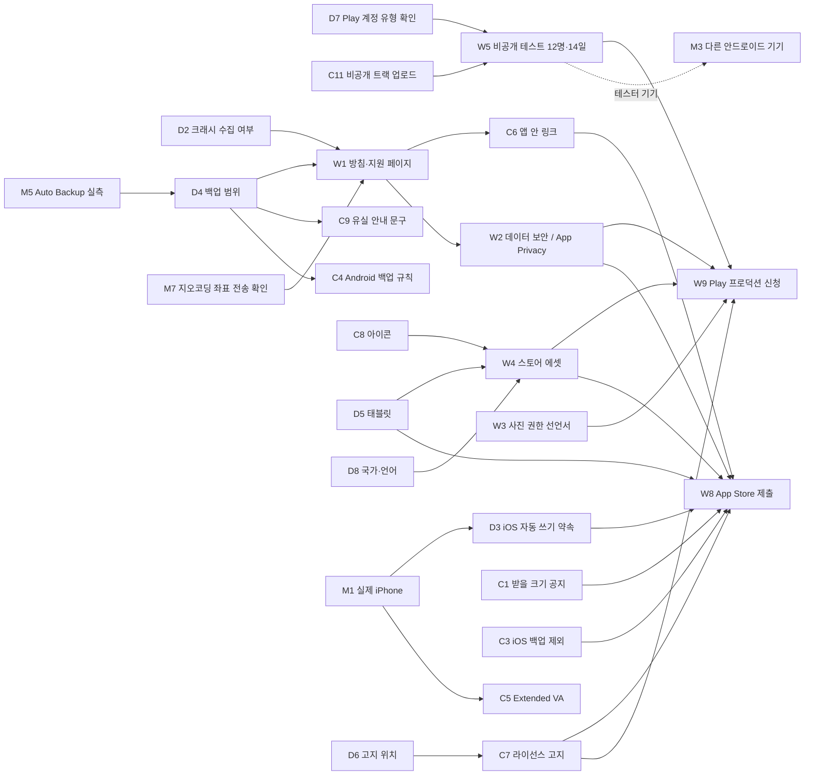

# 포켓로그(Pocketlog) 출시 준비도 분석

- **처음 작성**: 2026-10-11 (Antigravity, 커밋 e7837a0)
- **개정**: 2026-10-11. 이 저장소의 실측 기록(`AGENTS.md`·`specs/0xx-*/`)과 코드, 라이브러리 문서(context7), 스토어 공식 문서로 다시 확인했다.
- **기준 시점**: 076(안드로이드 release CI·Play 내부 테스트 versionCode 10)과 075(iOS CI·TestFlight 1.0.0 (4))가 끝난 때
- **목적**: 일반 사용자 대상 정식 출시(Google Play 프로덕션·App Store)까지 남은 일을 정리하고, 일 사이의 선후 관계를 드러낸다

> [!NOTE]
> 이 문서는 분석 문서다. 그래서 우선순위와 선후 관계를 적는다. 로드맵(`docs/roadmap/README.md`)은 진행 전 항목에 순서를 적지 않는다는 규칙이 있다. 여기 항목을 로드맵으로 옮길 때는 순서 표기를 빼고 옮긴다.

**근거 표식** — 각 서술 끝에 붙인다(헌법 원칙 V: 실측과 짐작을 가른다).

| 표식 | 뜻 |
| --- | --- |
| **[실측]** | 이 저장소에서 기기나 CI로 잰 값. 출처는 AGENTS 절 번호나 스펙 |
| **[코드]** | 저장소 파일을 직접 읽어 확인한 것 (`파일:줄`) |
| **[문서]** | 라이브러리 문서(context7)나 스토어 공식 문서로 확인한 것. 출처는 6장 |
| **[2차]** | 공식이 아닌 자료에서만 확인한 것 — 소유자가 콘솔에서 다시 봐야 한다 |
| **[미확인]** | 아무도 재지 않았거나 확인할 통로가 없었던 것 |

---

## 0. 처음 판에서 바뀐 것

**고친 것**

1. **Play 비공개 테스트 인원은 20명이 아니라 12명이다.** 조건은 14일 이상 연속 참여한 테스터 12명이다 [문서: Play Console 고객센터 14151465]. 이 조건은 새로 만든 **개인** 개발자 계정에만 붙는다. 이 저장소에는 Play 계정이 개인 계정인지 조직 계정인지 적힌 곳이 없다 [미확인]. 그래서 적용 여부부터 확인해야 한다.
2. **두 모델을 함께 적재하지 않는다.** 사진 모델을 열고, 캡션을 만들고, 닫은 뒤에 글 모델을 연다. 한 번에 모델 하나다 [실측: AGENTS 011]. 그래서 메모리의 최댓값은 두 모델의 합이 아니라 큰 쪽(글 모델 파일 1,522,796,768바이트)에 묶인다 [코드: `src/models/roster.ts:66`].
3. **「iOS 백그라운드는 약 30초」는 확인되지 않았다.** `expo-background-task` 문서가 말하는 것은 두 가지뿐이다. 간격은 시스템이 정하고, iOS에서는 짧은 간격이 자주 무시되어 밤 같은 정해진 창에 돈다 [문서: expo-background-task `minimumInterval`]. 실행 시간 한도는 문서에 없다. 실제 iPhone에서 재야 한다 [미확인].
4. **시뮬레이터의 「8토큰에 40~50초」는 기기 성능을 알려 주지 않는다.** 원인은 개발 맥의 메모리 부족(RAM 8GB, 스왑 약 15GB 사용)일 가능성이 크다. 소유자 결정으로 환경 한계로 닫았다 [실측: AGENTS 068]. 같은 시뮬레이터에서 066 당시에는 첫 실행부터 저장까지 약 50초가 걸렸다 [실측: AGENTS 066].
5. **「HuggingFace 직접 의존」은 사실이지만 바로 미러링하라는 결론이 서지 않는다.** 미러링은 모델 파일을 재배포하는 일이다. 라이선스 조건을 먼저 확인해야 하고(2.3절), 그다음이 소유자 결정이다.
6. **크래시 수집은 원칙 IV보다 개인정보 선언 문제가 먼저다.** 넣는 순간 "데이터를 수집하지 않는다"는 선언과 방침 문서가 바뀐다 [문서: Expo app-stores — 라이브러리에 따라 App Privacy 답이 달라진다].

**새로 찾은 것** (처음 판에 없었다)

- **App Store 4.2.3(ii)**: 첫 실행에 추가 자원을 받아야 하면 받을 크기를 알리고 먼저 물어야 한다 [문서]. 그런데 표준 동의 화면은 받을 양을 보이지 않는다 [코드: `src/i18n/catalogs/ko/download.ts:9-13`]. 045 FR-003에서 일부러 그렇게 정했다. 받을 양은 모바일 데이터일 때만 보인다(074). → **095로 해결(2026-10-21)** — 표준 동의에도 받을 양을 싣는다.
- **iOS 모델 2GB가 iCloud 백업 대상 자리에 있다.** 모델은 `Paths.document` 아래에 있고 [코드: `src/models/expo-port.ts:104`], 이 경로는 iOS의 `NSDocumentDirectory`다 [문서: expo-file-system `Paths.ts`]. `expo-file-system` 57에는 백업 제외 API가 없다 [코드: `node_modules/expo-file-system`에서 backup 0건].
- **Android `allowBackup="true"`에 백업 규칙이 없다** [코드: 생성된 `android/app/src/main/AndroidManifest.xml:21`]. Auto Backup 한도는 앱당 25MB다 [문서: developer.android.com autobackup]. 모델이 같은 `files/` 아래에 있어 한도를 넘는다. 넘었을 때 일기가 백업되는지는 공식 문서에서 찾지 못했다 [미확인].
- **완성 알림이 앱이 만든 채널로 가지 않는다.** `diary-completed` 채널은 만들지만 [코드: `src/schedule/notification-port.ts:62`], 알림을 보낼 때 `trigger: null`을 쓴다 [코드: 같은 파일 `:96`]. `null`이면 Expo가 기본 채널로 보낸다 [문서: expo-notifications `channelId`]. 특정 채널로 즉시 보내려면 `trigger: { channelId }`(`ChannelAwareTriggerInput`)를 써야 한다 [코드: `node_modules/expo-notifications/build/Notifications.types.d.ts:233`]. 062에서 실기기가 「Miscellaneous」 채널로 게시한 관측과 맞는다 [실측: AGENTS 062].
- **llama.rn README는 iOS에 두 가지 capability를 권한다**: Extended Virtual Addressing과 Increased Memory Limit [문서: llama.rn README]. 지금 프로파일에는 Increased Memory Limit 하나만 있다 [실측: AGENTS 「서명 주체」 — entitlement는 `increased-memory-limit` 하나].
- **`supportsTablet: true`이면 iPad에서 세로 고정이 풀린다.** Expo는 iPad 방향 네 가지를 모두 Info.plist에 넣는다(`requireFullScreen`이 없을 때) [문서: `@expo/config-plugins` `RequiresFullScreen.ts`]. `false`로 해도 앱은 iPad에서 휴대폰 해상도로 돈다. 그 화면이 깨지면 Apple이 거부할 수 있다 [문서: Expo app-stores 「Responsive design」].
- **모델 라이선스가 고지 의무를 지고, 그 의무가 헌법 원칙 III과 부딪칠 수 있다.** LFM Open License v1.0은 배포할 때 저작권·라이선스 고지를 남기라고 한다 [2차: ScanCode LicenseDB·Liquid AI 문서 요약]. 헌법 원칙 III은 모델 식별자를 사용자 화면에 보이지 말라고 한다. 고지를 어디에 둘지 정해야 한다(D6).
- **앱 아이콘이 자리표시자다.** iOS는 빨간 사각형에 「P」다 [실측: AGENTS 066]. 안드로이드 adaptive icon은 Expo 기본이다 [코드: `app.json` `adaptiveIcon.backgroundColor: "#E6F4FE"`].
- **앱 안에 개인정보처리방침·문의 링크가 없다** [코드: `src/i18n/catalogs/ko/settings.ts`에서 개인정보·문의 0건]. App Store 5.1.1(i)은 메타데이터와 **앱 안** 모두에 방침 링크를 요구한다 [문서].

---

## 1. 지금까지 확인된 상태

| 영역 | 상태 | 근거 |
| --- | --- | --- |
| 안드로이드 생성 경로 | dev 실기기 2대(SM-G986N Android 13, SM-S901N)에서 첫 실행부터 저장까지 확인. 층 1(12흐름 13분 26초)·층 2(4흐름 약 10분) 통과 | [실측: 069·070·073] |
| 안드로이드 release | CI가 서명 AAB를 만들어 Play 내부 테스트에 올렸다(versionCode 10, 약 13분 30초). Play에서 받은 앱이 전용 기기에서 돈다 | [실측: 076, 소유자 확인] |
| 안드로이드 생성 시간 | `quiet` 웜 2~3초, 포그라운드 콜드 54초, 헤드리스 158초. 사진 12장인 날 전체 약 138초. 생성 한도는 180초 | [실측: 024·023] |
| 안드로이드 백그라운드 | 배터리 최적화가 기본값이면 하루 1~2회로 억제된다(관측 간격 19시간 33분). 예외를 주면 10~32분 간격. Play 정책 때문에 예외 요청 권한은 뺐다 | [실측: 019·065] |
| iOS | 시뮬레이터에서만 첫 실행부터 저장까지 돌았다. TestFlight 1.0.0 (4)가 처리를 통과했다. **실제 iPhone은 0대** | [실측: 066·075] |
| GPU | 안드로이드 기기는 `i8mm`이 없어 CPU로 돈다. iOS의 사진 모델은 `use_gpu: false`로 고정했다(시뮬레이터 크래시와 llama.rn #176) | [실측: AGENTS 「안드로이드」·066] |
| 모델 | 3파일, 합계 2,004,831,040바이트(약 2.0GB). 모두 HuggingFace 직접 URL | [코드: `models/roster.ts:65-66`, `vision/roster.ts:81-93`] |
| 내려받기 | 구간 병렬과 이어받기 코드가 있다(`remainingSegments`). OOM은 해소됐다. 모바일 데이터일 때의 동의는 화면만 확인했고, 실제 `CELLULAR` 값은 보지 못했다 | [코드: `models/segmented/plan.ts:103`, 실측: 041·074] |
| 일기 품질 | 원칙 II 위반(기록에 없는 것을 단언)이 반복 관측된다. 캡션이 많은 날의 지어내기와 장면 중계가 남아 있다(캡션 상한 8은 소유자 결정) | [실측: AGENTS 「추론·프롬프트」·061·063] |
| 화면 언어 | 한국어 하나 | [코드: `src/i18n/`] |
| R8/minify | 꺼져 있다. 켰을 때를 실측한 적 없다 | [실측: AGENTS 027] |

---

## 2. 내부 — 코드와 앱

### 2.1 실기기 실측이 비어 있는 곳

**M1. 실제 iPhone (0대 — 가장 큰 기술 공백)**
- **잴 것**: TestFlight 빌드로 2GB 모델 적재(메모리 한도에 걸려 종료되는지), 생성 시간이 180초 한도 안에 드는지, CPU 캡션 시간(`use_gpu: false`), 백그라운드 자동 쓰기가 실제로 깨어나는지와 언제 깨어나는지 [미확인].
- **참고**: 메모리 최댓값은 글 모델 하나의 적재 크기다(0장 2번). Extended Virtual Addressing이 없어도 되는지도 이때 드러난다(C5).
- **뒤에 걸린 것**: D3(iOS 자동 쓰기를 약속할지), C5(capability 추가), App Store 제출(W8).

**M3. 다른 안드로이드 기기**
- 실측 기기는 삼성 2대뿐이다. 메모리가 적은 기기, 다른 제조사의 절전 정책, `i8mm`이 있는 기기(GPU 경로)는 본 적이 없다 [미확인].
- 비공개 테스트(W5) 테스터 기기가 첫 표본이 된다. 그래서 W5와 함께 하는 것이 싸다.

**M4. 실제 모바일 데이터(`CELLULAR`) 값** — 074의 모바일 동의 분기는 연결 값을 덮어써서 화면만 봤다. SIM이 무서비스라 실제 값은 못 봤다 [실측: 074].

**M5. Android Auto Backup이 실제로 무엇을 백업하는가** — `adb shell bmgr backupnow com.a810labs.pocketlog`과 logcat으로 본다 [미확인]. 결과가 D4(백업 정책)의 입력이다.

**M6. 출시 후보로 층 2 돌리기** — `docs/e2e/layer2-release-checklist.md`. 안드로이드 갈래만 있다.

**M7. 장소 이름 변환 때 좌표가 기기 밖으로 나가는가**
- `reverseGeocodeAsync`가 OS 지오코더(네트워크)를 쓰는지 context7 문서로는 확인하지 못했다(문서에 해당 절이 없다) [미확인].
- 사진 권한 문구는 「사진은 휴대폰 밖으로 나가지 않습니다」다 [코드: `app.json` `photosPermission`]. 개인정보 선언(W1·W2)을 쓰기 전에 사실을 정해야 한다.

### 2.2 코드로 고칠 것

| ID | 할 일 | 근거 | 선행 |
| --- | --- | --- | --- |
| **C1** | 표준 동의 화면에 받을 양을 보인다 — **095로 완료**(실기기 확인 남음) | App Store 4.2.3(ii) [문서]. 045 FR-003의 「표준 동의에는 용량을 노출하지 않는다」를 뒤집어야 한다 | 소유자 승인 (045 결정 번복) — 2026-10-21 승인 |
| **C2** | 완성 알림을 `trigger: { channelId: "diary-completed" }`로 보낸다 | 0장 「새로 찾은 것」 [코드·문서]. 지금은 사용자가 끌 수 없는 기본 채널이 생긴다 [문서: 「Default 채널은 지우지 못할 수 있다」] | 없음 |
| **C3** | iOS 모델을 iCloud 백업에서 뺀다(백업 제외 속성 또는 자리 옮김) | 모델 2GB가 `NSDocumentDirectory`에 있다 [코드·문서]. Apple 심사 지침의 「제출 전」 목록에 「iCloud 백업용 데이터 최적화」 문서가 있다 [문서] | 통로 조사(expo-file-system에 API 없음 → 설정 플러그인이나 네이티브 코드) |
| **C4** | Android 백업 규칙(`dataExtractionRules`·`fullBackupContent`)으로 모델을 빼고 일기를 어떻게 할지 정한다 | `allowBackup="true"`, 규칙 없음 [코드] | D4, M5 |
| **C5** | iOS에 Extended Virtual Addressing을 더한다(App ID capability와 프로파일 재발급) | llama.rn 권장 [문서]. 프로파일은 계정 소유주(Hyunmin Lee)만 고칠 수 있다 [실측: AGENTS 「서명 주체」] | M1(필요한지 실측), 소유주 |
| **C6** | 설정에 개인정보처리방침·문의 링크를 넣는다 | App Store 5.1.1(i)은 앱 안 링크를 요구한다 [문서] | W1(페이지 URL) |
| **C7** | 오픈소스·모델 라이선스 고지 | LFM 고지 의무 [2차]. Kanana 1.5는 Apache-2.0이다 [문서: HuggingFace 모델 카드]. llama.cpp 등 네이티브 라이브러리 고지도 함께 다룬다 | D6 |
| **C8** | 앱 아이콘 교체(iOS·Android adaptive) | 자리표시자 [실측·코드] | 디자인 산출물 |
| **C9** | 일기 유실 안내 문구(앱을 지우거나 기기를 바꾸면 일기가 사라진다는 한 줄) | 지금 설정에는 「일기 모두 지우기」 확인 문구만 있다 [코드] | D4 |
| **C10** | `supportsTablet` 정리 | 0장 「새로 찾은 것」 [문서] | D5 |
| **C11** | 릴리스 워크플로가 비공개 테스트 트랙에도 올리게 한다 | 서비스 계정은 **내부 테스트 트랙 권한만** 받았다 [실측: 076 quickstart §2]. 업로드 트랙도 `internal`로 고정돼 있다 | D7 (손으로 올려도 된다) |
| C12 | (선택) R8/minify 실측 | 켜면 동적 `import`와 JNI 심볼이 깨질 수 있다 [실측: AGENTS 027 — 짐작으로 기록됨]. release 검증은 소유자 요청이 있을 때만 한다 | 소유자 요청 |
| C13 | (선택) 빌드 번호 자동화 | 이미 로드맵 과제다 | 로드맵 과제의 소유자 결정 |

### 2.3 모델 배포와 라이선스

- **Kanana 1.5 2.1B instruct**: 원본 모델 카드의 라이선스는 `apache-2.0`이다 [문서: HuggingFace `kakaocorp/kanana-1.5-2.1b-instruct-2505`]. 실제로 받는 GGUF 저장소(`DevQuasar/…-GGUF`)에는 라이선스 표기가 없다. 원본을 양자화한 것이라고만 적혀 있다 [문서: HuggingFace].
- **LFM2.5-VL-450M**: 라이선스는 `lfm1.0`이다 [문서: HuggingFace 모델 카드]. 2차 자료 기준으로 연 매출 1천만 달러 이하 법인은 상업적으로 써도 되고, 배포할 때 고지를 남겨야 한다 [2차: Liquid AI 라이선스 페이지·ScanCode LicenseDB]. 원문은 소유자가 직접 읽는다.
- **미러링(자체 저장소)**: 위험은 실재한다. 원작자가 파일을 옮기거나 지우면 신규 설치가 멈춘다 [코드: URL 하드코딩]. 다만 재배포 조건과 운영 비용을 소유자가 정해야 한다(D1). 대역폭 제한(403·429)은 관측된 적 없다 [미확인].
- **처음 판의 「법적 최종 확인」은 유지한다.** 사람이 라이선스 원문을 읽는 일이다. 코드가 판정할 일이 아니다.

### 2.4 데이터 보존

- 일기·설정·모델은 모두 앱 데이터 안에 있다. 앱을 지우면 함께 사라진다 [실측: AGENTS 「서명이 다르면…」].
- 백업 동작은 두 플랫폼 모두 의도해서 정한 것이 아니라 기본값이다(C3·C4) [코드].
- **1.0 범위 판단**: 내보내기 기능은 출시 후로 미루고, 출시 전에는 유실 안내(C9)만 넣는다. 처음 판과 리뷰 둘 다 이렇게 의견을 모았다. 다만 이것은 **소유자 결정(D4)**으로 기록해야 하고, 개인정보처리방침의 보존·삭제 설명(5.1.1(i) 셋째 항)과 같은 말을 해야 한다.

### 2.5 크래시 파악

- 지금 앱 안에 오류 수집 도구가 없다. 오류 기록은 진단 화면의 「최근 쓰기 실패」(기기 안, 최근 10건)뿐이다 [실측: 060].
- 스토어 콘솔이 주는 기본 크래시 정보(Play Console, Xcode Organizer)로 충분한지 먼저 본다. 외부 SDK를 넣으면 W1·W2의 선언이 바뀐다(D2).

---

## 3. 외부 — 스토어 정책과 등록 정보

### 3.1 Google Play

| ID | 할 일 | 근거 | 선행 |
| --- | --- | --- | --- |
| **W5** | 비공개 테스트: 12명 이상, 14일 연속 | 새 개인 계정이면 프로덕션 신청 전 필수 [문서]. 인원이 12명 아래로 떨어지면 처음부터 다시 센다는 말은 [2차]다 | D7, C11 또는 손 업로드 |
| **W3** | `READ_MEDIA_IMAGES` 선언서 | 넓은 사진 접근은 「지속적이거나 잦은 접근이 필요한 핵심 기능」을 보이고 심사를 통과해야 한다 [문서: Play 고객센터 14115180]. 2차 자료에 따르면 양식은 갤러리·사진 편집 계열을 예로 든다 [2차]. 이 앱이 통과할지는 **확인되지 않았다** — 거부되면 핵심 기능이 무너지므로 가장 이른 위험 신호다 | 시연 영상(안정 빌드) |
| **W2** | 데이터 보안 섹션 | 방침과 같은 내용 | W1, D2, M7 |
| W6 | 콘텐츠 등급 설문·대상 연령 | 콘솔 필수 항목. 생성형 AI 관련 질문이 있는지는 [미확인] | — |
| W7 | 앱 액세스 안내(심사 메모) — 첫 실행에 약 2.0GB를 받는다는 것 | 크기는 [코드] 합계 | C1과 같은 문구 |
| **W4** | 등록 에셋: 스크린샷 최소 4장, 그 밖의 규격은 Play 공식 문서를 따른다 | [문서: Expo store-assets] | C8, D8 |
| W9 | 프로덕션 접근 신청 | W5를 마친 뒤 대시보드에서 신청한다 [문서] | W5, W2, W3, W4, W6 |

### 3.2 App Store

| ID | 할 일 | 근거 | 선행 |
| --- | --- | --- | --- |
| **C1** | 받을 크기 공지(앞 표) | 4.2.3(ii) [문서] | 소유자 승인 |
| **W1** | 개인정보처리방침 URL — 메타데이터와 앱 안 둘 다 | 5.1.1(i) [문서]. 수집하는 데이터, 보존·삭제, 동의 철회 방법을 적어야 한다 | D2, D4, M7 |
| W2 | App Privacy 답변 | 라이브러리에 따라 답이 달라진다 [문서: Expo] | W1, D2 |
| W4 | 스크린샷 — iPad를 지원하면 iPad용 2~10장(2064×2752 또는 2048×2732)이 더 필요하다 | [문서: Expo store-assets] | C8, D5 |
| W10 | 지원 URL | App Store Connect 메타데이터 [문서: EAS metadata 스키마 `supportUrl`] | W1과 함께 |
| — | 수출 규정 | `ITSAppUsesNonExemptEncryption: false`가 이미 있다 [코드: `app.json:15`] | 끝 |
| — | 권한 문구 | 한국어로 들어가 있다. 모션 문구가 없어 빌드 1이 ITMS-90683으로 거부된 것을 고쳤다 [실측: 066] | 끝 |
| **W8** | 심사 제출 | — | M1, C1, C3, C6, W1, W2, W4, D3, D5 |

---

## 4. 소유자 결정 목록

이 결정들이 서야 뒤의 일이 시작된다. 코드나 분석이 대신 정하지 않는다.

| ID | 결정 | 왜 지금 필요한가 | 막고 있는 일 |
| --- | --- | --- | --- |
| **D7** | Play 계정이 개인인지 조직인지 확인 (사실 확인) | W5의 14일 시계가 적용되는지가 여기서 갈린다 | W5 → W9 |
| **D2** | 크래시·오류 수집 SDK를 넣을지 | 방침과 데이터 선언의 내용이 갈린다 | W1, W2 |
| **D4** | 1.0의 백업 범위: 안내 문구만 / 최소 내보내기 / 플랫폼 백업 허용 | 방침의 보존 설명, C3·C4·C9가 갈린다 | C4, C9, W1 |
| **D6** | 라이선스 고지를 어디에 둘지 (앱 안 화면이면 원칙 III과 조정이 필요하다 — 헌법을 먼저 고칠지, 앱 밖 페이지로 할지) | LFM 고지 의무 [2차] | C7 |
| **D1** | 모델 미러링 여부 | 라이선스 확인 뒤에 판단할 수 있다 | (선택) 인프라 작업 |
| **D5** | `supportsTablet`: `false`로 갈지 | iPad 스크린샷과 방향 문제가 갈린다. `false`여도 iPad 호환 모드 점검은 필요하다 | C10, W4(iOS), W8 |
| **D3** | iOS에서 「매일 쓰는 시각」을 약속할지 | M1 결과를 보고 정한다. 약속하지 않으면 설정 문구를 고친다 | W8 |
| **D8** | 출시 국가와 등록 정보 언어 (화면 언어는 한국어 하나) | 에셋과 설명문의 수가 정해진다 | W4 |
| — | C1: 045 「표준 동의에 용량 비노출」을 뒤집는 승인 | App Store 요건 | C1 → W7·W8 |

---

## 5. 우선순위와 선후 관계

### 5.1 관계도

### 5.2 우선순위

**P0 — 기다리는 시간이 길거나, 거부되면 핵심 기능이 무너지는 것. 먼저 연다.**

| 순 | 일 | 이유 |
| :-: | --- | --- |
| 1 | D7 → C11(또는 손 업로드) → **W5 시작** | 14일 시계가 Play 쪽 가장 긴 경로다. 테스트 중에도 빌드는 바꿀 수 있으므로, 다른 일이 끝나기를 기다리지 않고 지금 빌드로 시작한다 [2차: 기간 중 빌드 갱신 허용은 콘솔에서 확인] |
| 2 | **W3 사진 권한 선언서** | 거부되면 「그날 사진 전체를 읽는다」는 핵심 기능이 Play에서 막힌다 [문서]. 결과가 일찍 나올수록 대응 여지가 크다. 지금 빌드로 시연 영상을 찍을 수 있다 |
| 3 | **M1 실제 iPhone** | iOS 쪽 모든 결정(D3·C5)의 입력이다. 빌드 1.0.0 (4)가 이미 TestFlight에 있다 |
| 4 | **D2·D4·M7 → W1** | 두 스토어 모두 방침 URL이 없으면 제출할 수 없다. 결정 셋이 내용을 정한다 |

**P1 — 제출 전에 반드시 끝나야 하지만, 오래 기다리는 일은 아닌 것**

- C1(받을 크기 공지, App Store 요건) · C2(알림 채널, 작은 수정) · C3(iOS 백업 제외 — 통로 조사가 먼저) · C6(앱 안 링크, W1 뒤) · C8(아이콘) · C9(유실 안내, D4 뒤) · D5→C10 · D6→C7 · W2 · W4 · W6 · W7 · W10
- M5(Auto Backup 실측)는 D4 앞에 둔다.

**P2 — 출시 후로 미뤄도 되는 것 (소유자 결정에 따라)**

- D1 미러링, C12 R8, C13 빌드 번호 자동화, 일기 내보내기, 다국어, M4(실제 `CELLULAR` 값 — SIM이 되는 기기가 생기면).

### 5.3 경로 요약

- **Play 경로**: D7 → W5(14일) → W9. W5와 동시에 W3·W1·W2·W4·C8을 끝내야 W9가 14일 뒤에 바로 열린다.
- **App Store 경로**: M1 → D3 → W8. 동시에 C1·C3·C6·W1·W2·W4가 필요하다. 14일 같은 대기는 없지만, M1에서 메모리 문제가 나오면 C5(계정 소유주의 프로파일 재발급)가 끼어든다.
- **공통 병목**: W1(방침)이 두 스토어 모두의 선행이고, W1은 소유자 결정 D2·D4에 달려 있다. 결정 둘이 가장 이른 소유자 몫이다.

---

## 6. 확인 출처

**저장소**: `AGENTS.md` 각 절(019·023·024·027·041·045·060·061·062·063·065·066·068·069·070·073·074·075·076), `app.json`, `src/models/roster.ts`, `src/vision/roster.ts`, `src/models/expo-port.ts`, `src/schedule/notification-port.ts`, `src/i18n/catalogs/ko/download.ts`·`settings.ts`, `android/app/src/main/AndroidManifest.xml`(prebuild 생성물), `node_modules/expo-notifications/build/Notifications.types.d.ts`, `node_modules/expo-file-system`, `.specify/memory/constitution.md`.

**context7** (2026-10-11 조회)

| 라이브러리 | 질의 | 얻은 것 |
| --- | --- | --- |
| `/expo/expo` | expo-background-task iOS 동작 | `minimumInterval` 기본 12시간·최소 15분. iOS는 짧은 간격을 자주 무시하고 밤 같은 창에 돈다. 실행 시간 한도는 문서에 없다 |
| `/expo/expo` | expo-notifications `channelId` | `channelId`가 없으면 「Default」 채널을 만들어 쓴다. 그 채널은 지우지 못할 수 있다 |
| `/expo/expo` | expo-file-system `Paths.document` | iOS는 `NSDocumentDirectory`, Android는 `filesDir`. 백업 제외 API는 문서에 없다 |
| `/expo/expo` | `supportsTablet` | `requireFullScreen` 없이 태블릿을 지원하면 iPad 방향 넷을 강제한다. `false`여도 iPad에서 돌아야 한다 |
| `/expo/expo` | 스토어 에셋·방침 | Play 스크린샷 최소 4장, iPad 스크린샷 규격, iOS 방침 필수, App Privacy |
| `/expo/expo` | `reverseGeocodeAsync` | 네트워크 사용 여부를 확인할 문서를 찾지 못했다 (M7) |
| `/mybigday/llama.rn` | iOS capability·Metal | Extended Virtual Addressing과 Increased Memory Limit을 권한다. 시뮬레이터에서는 Metal이 안 된다 |

**스토어·라이선스 공식 문서**
- [App Store Review Guidelines](https://developer.apple.com/app-store/review/guidelines/) — 4.2.3(ii), 5.1.1(i), 2.5.2, 「Before You Submit」의 iCloud 백업 최적화 문서 링크
- [Play Console 고객센터 — 새 개인 계정의 테스트 요건](https://support.google.com/googleplay/android-developer/answer/14151465)
- [Play Console 고객센터 — 사진·동영상 권한 정책](https://support.google.com/googleplay/android-developer/answer/14115180)
- [Android Auto Backup](https://developer.android.com/identity/data/autobackup) — 앱당 25MB
- [HuggingFace kakaocorp/kanana-1.5-2.1b-instruct-2505](https://huggingface.co/kakaocorp/kanana-1.5-2.1b-instruct-2505) · [LiquidAI/LFM2.5-VL-450M-GGUF](https://huggingface.co/LiquidAI/LFM2.5-VL-450M-GGUF) · [DevQuasar GGUF](https://huggingface.co/DevQuasar/kakaocorp.kanana-1.5-2.1b-instruct-2505-GGUF)

**2차 자료** (소유자가 원문이나 콘솔에서 다시 확인할 것)
- [Liquid AI LFM License](https://www.liquid.ai/lfm-license), [ScanCode LicenseDB lfm-open-1.0](https://scancode-licensedb.aboutcode.org/lfm-open-1.0.yml) — 매출 기준, 고지 의무
- [Choicely — 12 tester rule](https://www.choicely.com/blog/google-play-12-tester-rule) — 20명에서 12명으로 바뀐 이력, 인원이 줄면 다시 센다는 주장
- [Android Authority — photo picker](https://androidauthority.com/google-force-android-photo-picker-3491650) — 선언서 양식이 예로 드는 앱 범주
