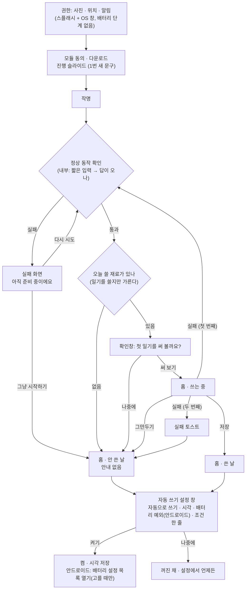

# 안내 규칙 — 앱이 사용자에게 하는 말과 그 자리

> **상태: 규칙과 결정 확정(소유자, 2026-10-31).** 결정은 0장, 구현은 0-4의 묶음으로 한다. 문구 초안으로 표시한 것은 구현 때 사람이 확정한다(헌법 원칙 V).
> 로드맵 항목은 이 문서를 가리킨다 — 상세는 여기에만 둔다. 앱·문구를 고치는 일은 0-4의 묶음마다 별도 PR로 한다.

**기준 하나**: 어느 화면도 다른 화면과, 그리고 실측과 어긋나는 말을 하지 않는다.

## 0. 정한 것 (소유자, 2026-10-31)

소유자가 정한 것이다. 이 문서의 나머지보다 우선한다. 선택지와 장단점을 견준 이력은 git 기록에 있다.

| # | 결정 | 정한 것 |
| --- | --- | --- |
| D1 | 첫 실행 — 자동 첫 일기 | **재료로 가른다.** 정상 동작 확인은 재료와 상관없이 늘 한다. 재료가 있으면 확인창을 띄우고, 확인하면 쓴다. 재료가 없으면 안내 없이 일기만 쓰지 않는다(안 쓴 날 화면) |
| D2 | 「자동으로 쓰기」 | **D1이 끝난 뒤 설정 창 하나**에서 자동으로 쓰기·시각·배터리 예외(안드로이드)를 한 번에 정한다 |
| D2-b | 앱이 무엇인지 | 진행 슬라이드 1을 고친다. 문구(소유자): 「AI가 쓰는 일기」 / 「주인님의 하루를 글로 남겨요. 실수할 때도 있지만요」. 스플래시 캡션도 「AI가 쓰는 일기」로 맞춘다 |
| D3 | 약속 세기 | (나) — OS가 깨우는 쓰기는 **「써 드릴 수 있어요」**, 앱이 하는 일만 단정. **세부 조건은 말하지 않고 두루뭉술하게** 말한다 |
| D4 | 홈 배터리 안내 자리 | A + C — 쓴 날 지면 맨 끝 + 설정 보조 줄 |
| D5 | 「자동으로 쓰기」 아래 조건 줄 | 둔다. 문구(소유자): iOS 「이 시간에 충전중이라면 자동으로 작성해요」 / 안드로이드 「이 시간에 배터리 제한을 풀거나 충전중이라면 자동으로 작성해요」 |
| D6 | 슬라이드 4 | 방침 수준으로 낮춘다(초안: 「사진과 일기는 서버로 보내지 않아요」) |
| D7 | 말투 T1~T7 | 「AI slop」 과제 할 일 2와 함께 정한다 |
| L1 | 정상 동작 확인 | 실제 모델에 짧은 입력을 보내 **답이 오는지만** 내부에서 확인한다(사용자에게 보이지 않음). 035 — **F1: 같은 입력, 답을 확인 전용 상한(16토큰)에서 끊는다**(0-2, 소유자 확정, 108) |
| L2 | 첫 일기 쓰기 실패 | 막다른 길로 두지 않는다 — **정상 동작 확인으로 돌아가** 다시 통과하게 한다. 자동 되돌림은 **한 번**(0-2, 소유자 확정) |
| U1 | 첫 실행 배터리 단계 | **첫 실행 권한 단계에서 뺀다** — D2의 설정 창으로 옮겨 사진·위치·알림 단계와 모양을 통일한다(0-3) |

**정하면서 걷은 것**:

- D2-b가 화자를 「AI」로 소개하므로 2장 T2(정체 소개에 「AI」 금지)와 5장 K7을 걷었다.
- D3 「두루뭉술」과 R0에 따라 1-2의 세기 구분·R2·R5와 5장 K2의 세기 검사를 걷었다. FAQ iPhone의 세부 조건 셋도 이 결정으로 걷었다(108).

### 0-1. 첫 실행 흐름 (정한 뒤)

- 설정 창은 **쓰는 중에는 띄우지 않는다**(R8) — 쓰기가 끝난 뒤(저장·실패) 또는 쓰지 않기로 정해진 뒤에 한 번 띄운다(가정 A10).
- 이 창은 첫 실행에 **한 번만** 뜬다. 「나중에」를 고르면 다시 묻지 않고, 설정 「자동으로 쓰기」 행이 같은 창을 연다(초안 — 설정에서 같은 부품을 쓸지는 구현 때 정한다).

문구 초안(사람이 확정):

| 자리 | 초안 |
| --- | --- |
| D1 확인창 제목 | 「오늘 사진으로 첫 일기를 써 볼까요?」 |
| D1 확인창 본문 | 「사진과 다닌 곳으로 하루를 짐작해 써요. 몇 분 걸릴 수 있어요.」 |
| D1 버튼 | 「써 보기」 / 「나중에」 |
| D2 창 제목 | 「매일 일기를 써 드릴까요?」 |
| D2 행 | 「자동으로 쓰기」(토글) · 「쓰는 시각」(지금 기본 시각) · 「배터리 제한 풀기」(안드로이드, 꼬리표 「허용됨」/「허용 안 함」 — 104의 상태 읽기를 쓴다) |
| D2 조건 줄 | D5 문구 |
| D2 버튼 | 「켜기」 / 「나중에」 |

### 0-2. 정상 동작 확인과 첫 일기 실패 (L1·L2)

**지금 있는 것**(소스 확인):

- 확인은 이미 실제 모델로 돈다 — `src/inference/on-device.ts` `checkLiveness()`가 글 모델을 올리고(`engine.load`) 고정 입력 `LIVENESS_INPUT`(「안녕?」, `src/welcome/liveness.ts`)을 보낸 뒤 `judgeLiveness()`로 **모델이 열렸나 · 시간 한도 안인가 · 답이 비지 않았나** 셋만 본다. 답은 판정 직후 버린다(화면에 나가지 않는다). 끝나면 모델을 내린다.
- **F1(108)**: 답은 확인 전용 상한 `LIVENESS_MAX_TOKENS`(16토큰, 사람이 정한 값 — 측정 아님)에서 끊는다. 이 상한은 그 호출에만 걸리고(`RunLimits.maxTokens`) 일기 본문·제목 상한(`SAMPLING.n_predict`)은 그대로다. 한도는 `LIVENESS_TIMEOUT_MS`(적재 시간 제외).
- 보지 않는 것: **사진을 읽는 모듈(VLM)의 적재.** 첫 일기에 사진이 있으면 그 모듈이 처음 열리는 곳은 쓰기 도중이다. 확인에 이것을 더하는 안(F3)은 소유자가 고르지 않았다(F1만, 2026-10-31).
- 실패 화면(`src/ui/WelcomeScreen.tsx` `phase === "failed"`): 제목 「아직 준비 중이에요」, 본문 「잠시 후 다시 시도해 주세요.」, 버튼 [다시 시도](확인을 다시 돌린다) · [그냥 시작하기](확인을 건너뛰고 홈으로 — `App.tsx` `onSkipLiveness`, 「확인됨」으로 기록하지 않아 **첫 자동 일기도 돌지 않는다**). 오류 원문은 보이지 않는다(원칙 III).
- 첫 일기 쓰기 실패: `triggerFirstRunAutoDiary()`가 조용히 삼킨다. 「최근 실패」 기록만 남고 화면은 안 쓴 날로 남는다 — 막다른 길은 아니지만 사용자는 실패를 모른다.

**L2 — 첫 일기가 실패하면**(0-1 흐름도):

1. 첫 번째 실패 → **정상 동작 확인으로 돌아간다.** 통과하면 D1 판정(재료 → 확인창)을 한 번 더 거친다. 확인에 실패하면 실패 화면([다시 시도]/[그냥 시작하기])이 그대로 받는다.
2. 두 번째 실패 → 되돌리지 않는다. 실패 토스트를 띄우고 홈(안 쓴 날)으로 간다 — 하단 「일기 쓰기」가 다음 행동이다. 되돌림을 한 번으로 묶는 것은 「확인은 통과하는데 쓰기는 늘 실패하는」 경우(판정 거부 등)에 끝없이 돌지 않게 하려는 것이다.
3. 사용자가 「그만두기」를 누른 것은 실패가 아니다 — 되돌리지 않는다.
4. 되돌릴 때 사용자에게 보이는 말은 지금의 확인 중 화면 그대로다(새 문구 없음).

**함께 바뀌는 것**(L2): `App.tsx`의 첫 일기 트리거(실패를 삼키지 않고 결과를 받아 단계로 되돌림), `src/firstrun/progress.ts`(되돌림 횟수 — 세션 로컬), e2e 흐름표.

### 0-3. 배터리 예외 단계 통일 (U1)

**지금 다른 점**(`src/ui/OnboardingScreen.tsx`): 사진·위치·알림 단계는 스플래시 배경만 두고 OS 권한 창이 저절로 뜬다(043·065). 배터리 단계만 글 화면이다 — 「시작하기 전에」 제목·안내·「n / N」·설명 두 줄·[허용]/[건너뛰기]를 그리고, [허용]은 OS 창이 아니라 설정 목록을 연다(065, Play 정책). 자동 진행 타이머도 없다(결과를 읽을 API가 없다는 040의 판단 — 104부터는 `battery-exception-port.ts`로 읽을 수 있다).

**정한 것**: 이 단계를 첫 실행에서 뺀다. 배터리 예외는 D2 설정 창의 한 행이 된다. 그러면 첫 실행 권한 단계는 모두 「스플래시 + OS 창」 한 모양이다.

- 함께 바뀌는 것: `src/onboarding/requirements.ts`의 단계 목록, `batteryNoticeShown` 플래그의 뜻, 온보딩 문구 `onboarding.permissions.battery-exception`(설정 창으로 옮기거나 걷는다), e2e 흐름(`docs/e2e/feature-flow-map.md`)·`firstrun/` 테스트.
- **D2보다 먼저 내보낼 일이 생기면**(중간 상태): 배터리 단계를 스플래시 위 `ConfirmDialog` 하나(설명 + 「설정 열기」/「건너뛰기」)로 바꿔 「배경 + 창」 모양만 맞춘다. 첫 실행에서 배터리를 묻지 않는 기간을 만들지 않으려는 안이다.
- 구현은 이 문서가 확정된 뒤 별도 PR로 한다(로드맵 「위험」 — 문서 확정과 수정을 한 PR로 묶지 않는다).

이 문서가 다루는 것은 「앱이 사용자에게 하는 안내」다 — 설명·약속·경고·질문·알림. 일기 본문(프롬프트, 원칙 II)과 개발 빌드 전용 화면(개발자·진단)의 문구는 범위 밖이다. 단, 개발자 토스트는 갈래 정리에만 넣었다.

---

### 0-4. 구현 묶음

0장의 결정을 코드·문구로 옮기는 일은 아래 묶음들이다(G1 문구는 108, G2 정상 동작 확인 단축은 이 PR로 끝나 행을 지웠다). **묶음마다 별도 PR**이고, 각 PR은 dev 빌드로 실기기에서 한 번 이상 본다(헌법 원칙 V). 「먼저」 칸은 우선순위가 아니라 **코드가 기대는 것**이다.

| 묶음 | 내용 | 먼저 | 실기기에서 볼 것 |
| --- | --- | --- | --- |
| **G3 첫 일기 분기** | D1(재료 → 확인창 → 쓰기), L2(실패 시 확인으로 한 번 되돌림, 두 번째는 토스트) | — | 재료 있음·없음, 실패 되돌림, e2e 흐름표 |
| **G4 자동 쓰기 설정 창** | D2 설정 창, U1 배터리 단계 이동, D5 조건 줄, 함께 걸린 문구(슬라이드 3 제목·권한 설명·스토어 설명문) | G3(「D1이 끝난 뒤」 시점) | 안드로이드 배터리 설정 왕복, 쓰는 중에는 안 뜨는지 |
| **G5 홈 배터리 안내 자리** | D4 — 쓴 날 지면 맨 끝, `NOTICE_FONT_CAP` 걷기 | — | 글꼴 2.0배, 접힘 스크롤(052) |
| **G6 잠금 테스트** | 5장 K1·K3·K4·K8·K9·K11 등 남은 것 | G1·G3~G5 | — |

- **G4는 쪼개지 않는다** — 배터리 단계만 먼저 빼면 설정 창이 나올 때까지 배터리 예외를 묻는 곳이 없다.
- **G3·G4는 같은 파일**(`App.tsx` 첫 실행 단계, `src/firstrun/progress.ts`)을 고친다 — 차례로 한다. 첫 실행 기기 확인이 비싸면(모델 재다운로드) 둘을 한 PR로 합쳐도 된다.
- **첫 실행을 다시 볼 때** 모델을 지우지 않는 길(개발자 메뉴 「온보딩부터 다시」)로 되돌릴 수 있는지 먼저 확인한다 — `pm clear`·재설치는 모델을 지운다(AGENTS).
- 문구를 바꾼 PR은 문구 골든을 다시 쓰지 않고 `CHANGED_AFTER_GOLDEN`에 올린다. 스토어 설명문은 저장소를 고친 뒤 출시 때 콘솔에 올린다.
- 말투 T1~T7은 이 묶음에 넣지 않는다(D7).
- **묶음이 끝나면 이 문서를 줄인다** — 그 묶음의 행을 이 표와 4장 전수 목록에서 지우고, 남는 것은 규칙(1~3장·5장)뿐이게 한다(AGENTS 「뒤의 기능이 앞의 결정을 뒤집으면 … 고치거나 지운다」).

## 1. 사실의 원천과 약속의 세기

### 1-1. 원천은 주제마다 하나다

| 주제 | 원천 | 안내가 넘지 않는 선 |
| --- | --- | --- |
| 자동 쓰기가 언제 되는가(OS가 깨우는 쓰기) | [조건표](background-write-conditions.md) | 표의 칸 |
| 휴대폰 밖으로 나가는 것·보존 | [개인정보처리방침](../site/privacy/index.html)(근거: 086·099) | 방침의 「휴대폰 밖으로 나가는 것」·「보존과 삭제」 |
| 앱이 스스로 하는 일(앱 열기 쓰기·이어 하기·알림 누름·건너뜀) | 소스의 판정 함수(`src/schedule/decision.ts`·`auto-write.ts`, `src/app/continued-write.ts`) | 판정이 실제로 거는 조건 |
| 첫 실행 흐름 | `src/firstrun/`·`App.tsx`·040·045·046 | 실제 단계 순서 |

**규칙 R1**: 같은 사실을 둘 이상의 자리가 말하면 모두 같은 원천을 본다. 원천이 바뀌면 그 사실을 말하는 자리 전부(아래 4장 목록)를 함께 고친다.

### 1-2. 화면 문구의 말투 — 낱말로 다투지 않는다

- **R0 — 말꼬리 잡기 금지(소유자, 2026-10-31).** 화면 문구의 낱말 세기(「~할 수 있어요」와 「~해요」, 「써 드릴 수 있어요」와 「써 둘 때가 있어요」 같은 차이)를 모순·초과 약속으로 올리지 않는다. 「~할 수 있어요」는 안 될 수도 있다는 뜻을 이미 품는다. 소유자가 정한 문구는 낱말 세기를 이유로 다시 고치자고 하지 않는다.
- **모순으로 올리는 것은 뜻이 반대일 때뿐이다**: 안 되는 것을 된다고 하거나 되는 것을 안 된다고 할 때, 기본값·조건이 빠져 반대로 읽힐 때(예: 꺼져 있는데 늘 된다고 읽힘), 원천(방침 등)과 사실이 다를 때.
- **R3 — 시각을 약속하지 않는다.** 정각·「제때」는 쓰지 않는다. 시각이 들어가는 약속은 「쯤」과 「알린다」까지다(020·085).
- 자동 쓰기는 두루뭉술하게 말한다(D3). 세부 조건(저전력 모드·백그라운드 앱 새로 고침 등)은 화면·FAQ에 늘어놓지 않는다.

### 1-3. 플랫폼 짝

- **R6** — 플랫폼마다 사실이 다르면 두 플랫폼 문구를 **짝으로** 둔다(`settingsPlatform`). 한쪽만 있으면 다른 쪽에 「말하지 않는 까닭」을 주석으로 남긴다. 지금 짝이 비어 있는 것: 쓰는 중 안내(`writingLeaveNoteIos` — 안드로이드는 앞을 벗어나면 멈추는데 말하지 않는다).
- **R7** — 기기·OS 버전 조건이 있는 사실(예: 이어 하기는 iOS 26 이상)은 그 버전을 판정해 문구를 고르거나, 문구가 조건을 말한다. 판정 없이 단정하지 않는다.

---

## 2. 말투 (「AI slop」 조사를 입력으로)

[docs/ai-slop-survey.md](ai-slop-survey.md) 1-3·2-4의 문구 항목을 입력으로 쓴다. **기준은 그 과제의 할 일 2(소유자 선택)가 정한다** — 여기서는 안내 문구에 걸리는 것만 잠정 규칙으로 둔다. 확정되면 이 절을 그 결정으로 바꾼다(7장 「나중에 합칠 자리」).

| 규칙(초안) | 입력 | 지금 어긋나는 곳(4장) |
| --- | --- | --- |
| **T1** 앱 화면은 해요체 하나(048). 웹 문서(방침·FAQ)는 한 페이지 안에서 하나로 | 조사 2-4 「맺음꼴 섞임」 | 첫 실행 권한 화면의 합쇼체, FAQ 마지막 답의 해요체 |
| ~~T2~~ **걷음(D2-b)** — 소유자가 「AI가 쓰는 일기」로 정했다 | 조사 C7·C2 | — |
| **T3** 호칭은 하나 — 「주인님」인지 「주인」인지 정한다 | 조사 2-4 「호칭 흔들림」 | `welcome.welcomeBody`·`download.slides[0]` vs `monologue` |
| **T4** 실패·빈 상태는 기분이 아니라 다음 행동을 말한다. 원인은 숨겨도 된다(원칙 III) | 조사 C3 | `😢` 두 제목, 첫 자동 일기 실패의 무언(0-2) |
| **T5** 안내 문구에 이모지·장식 화살표를 넣지 않는다 | 조사 C12·L6 | `😢`(안내 제목). `🤖`·`→`은 안내가 아니라 조사 과제가 정한다 |
| **T6** 앱이 자기 일을 칭찬하거나 다짐하지 않는다(「멋진」·「잘 …해볼게요」) | 조사 C7·C8 | `welcome.welcomeBody` |
| **T7** 같은 행동은 흐름 내내 같은 이름 — 「쓰기/일기 쓰기/다시 쓰기」, 「다운로드」 | 조사 C11 | (큰 어긋남 못 찾음 — 방침의 「받습니다」 vs 앱의 「다운로드」는 웹·앱 차이로 둔다, 가정 A6) |

---

## 3. 안내의 갈래와 자리

### 3-1. 지금 있는 방식 → 네 갈래

| 지금 방식 | 갈래 | 위치 |
| --- | --- | --- |
| ① 홈 배터리 안내 | **닫을 수 있는 안내** | `DiaryListScreen.tsx` `BatteryNoticeLine`(스트립 아래), `use-battery-notice.ts`, 숨김 기간 `BATTERY_NOTICE_HIDE_MS` |
| ② 실패 토스트 | **지나가는 알림** | `FailureToast.tsx`, 수명 `TOAST.showMs` |
| ⑥ 개발자 토스트 | 지나가는 알림(개발 빌드) | `DeveloperToast.tsx` |
| ⑦ OS 알림 — 쓸 차례·완성·이어 하기 진행 | 지나가는 알림(**앱 밖**) | `reminder`·`notification`·`continued` 카탈로그 |
| ③ 대화상자 — 덮어쓰기·재료 확인·사진 설정·지우기·다운로드 동의·모바일 데이터·다시 받기 | **확인이 필요한 질문** | `Dialog.tsx`·`MaterialDialogs.tsx`·`DownloadConsentDialog.tsx`·`CellularConsentDialog.tsx` 등 |
| ⑧-1 첫 실행 권한 요청(OS 권한 시트 앞 설명) | 확인이 필요한 질문 | `OnboardingScreen.tsx`, `onboarding` 카탈로그 |
| ④ 설정 꼬리표·보조 줄 — 권한 꼬리표, `permBatteryHint*`, `notificationOff`, `skippedLine`, `lossNotice`, `placeNotice`, 시각 미리보기 | **설정의 설명** | `SettingsScreen.tsx`, `settings`·`settingsPlatform`·`reminder`·`lossNotice` |
| ⑤ 쓰는 중 안내 한 줄(iOS) | 설정의 설명(**자리에 붙은 설명**) | `leave-note.ts`, `WritingPaper` |
| ⑧-2 첫 실행 진행 슬라이드·작명 화면 | 설정의 설명(첫 실행) | `DownloadProgressScreen.tsx`·`WelcomeScreen.tsx` |
| ⑨ 도움말 FAQ·방침·스토어 설명문 | 설정의 설명(**앱 밖**) | `site/support`·`site/privacy`·`store/ko/` |
| (덧붙임) 캐릭터 옮김 안내 `movedNotice`, 쓰기 전 실패 화면 `needsAuthor` | 지나가는 알림 / 닫을 수 있는 안내 사이 | `DiaryHomeScreen.tsx` |

### 3-2. 갈래별 규칙 (초안)

| | 닫을 수 있는 안내 | 지나가는 알림 | 확인이 필요한 질문 | 설정의 설명 |
| --- | --- | --- | --- | --- |
| **무엇을** | 사용자가 할 수 있는 일 하나(설정 바꾸기 등) | 방금 일어난 일의 결과 | 되돌릴 수 없거나 비용이 드는 행동 직전의 선택 | 그 자리의 기능이 실제로 하는 일과 조건 |
| **언제** | 그 사실을 사용자가 **방금 겪은 뒤**(예: 앱 열기 쓰기가 저장된 뒤) | 사건 직후 한 번 | 행동 직전에만 | 늘 |
| **어디에** | 본문·캐러셀·쓰기 바를 밀지 않는 자리(3-4) | 하단 바 위(앱 안), OS 알림(앱 밖) | 모달 | 해당 행 바로 아래 한 줄 |
| **몇 번** | 화면에 하나. 닫으면 정한 기간 동안 안 보임(사람이 정한 값) | 같은 사건에 한 번 | 한 번에 하나 | — |
| **어떻게 닫나** | 「닫기」 + 행동 버튼 하나 | 저절로 + 쓸어 닫기. **다음 행동이 필요하면 토스트가 아니라 다른 갈래로** | 두 버튼, 기본은 취소 쪽 | 닫지 않는다 |
| **하지 않는 것** | 쓰는 중에 보이기, 둘 이상 쌓기 | 행동 버튼 넣기, 3초 안에 읽어야 할 긴 글 | 정보만 주는 대화상자 | 약속(설명은 사실만) |

### 3-3. 한 화면에 둘 이상일 때

**R8 — 우선순위**: 확인 질문 > 지나가는 알림 > 닫을 수 있는 안내 > 설정의 설명.

- 질문이 떠 있는 동안 토스트·안내는 나오지 않고 질문이 닫힌 뒤에도 다시 나오지 않는다(토스트는 버린다, 안내는 다음 기회로).
- 토스트와 안내가 같은 자리를 쓰면(3-4의 선택지 B) 토스트가 이기고 안내는 그 사이 숨는다.
- 닫을 수 있는 안내는 **화면당 하나**. 후보가 둘이면 사용자가 방금 겪은 일과 가까운 쪽 하나만.
- 쓰는 중 화면에는 쓰는 중 안내 한 줄 말고는 안내를 두지 않는다(지금도 배터리 안내는 쓰는 중이 아닐 때만 보인다).

### 3-4. 본문을 밀어내지 않는 자리 — 홈 배터리 안내의 새 자리

**소유자 관찰**: 지금 자리(스트립 아래)가 나쁘다 — 본문 위를 밀어 내린다. 그래서 글꼴 배율 상한(`NOTICE_FONT_CAP`)까지 걸었는데, 그것이 다시 접근성을 깎는다(3-5).

| 선택지(초안) | 장점 | 단점 |
| --- | --- | --- |
| **A. 쓴 날 지면의 맨 끝(본문 다음)** — 앱 열기 쓰기로 저장된 그 날의 글을 다 읽은 자리 | 본문을 밀지 않는다. 사건(「앱을 열어서 써졌다」) 바로 뒤라 맥락이 맞다. 글꼴 상한이 필요 없다 | 끝까지 읽지 않으면 못 본다(닫힌 게 아니라 안 본 것 — 다음 기회에 다시). 접힘 스크롤(052)과 함께 확인 필요 |
| B. 하단 쓰기 바 바로 위 띠(토스트 자리) | 늘 보인다 | 토스트와 자리를 다툰다(R8). 본문 끝을 가리므로 스크롤 여백을 더해야 한다. 캐러셀·바와 겹쳐 한 화면이 붐빈다 |
| C. 홈에서 빼고 설정으로만(배터리 행 꼬리표 + 「자동으로 쓰기」 조건 줄) | 홈이 깨끗하다. 설정 설명과 한 벌이 된다 | 설정을 열지 않는 사용자에게는 닿지 않는다 — 104가 홈에 둔 까닭이 사라진다 |
| D. 쓰기 바 안 | 공간 추가 없음 | 바는 행동 자리다. 한 줄이 들어가면 버튼 라벨과 다툰다. 큰 글꼴에서 가장 먼저 깨진다 |

**정함(D4): A + C** — 홈에서는 A, 설정은 늘 같은 사실을 보조 줄로 말한다. 근거: 이 안내는 「다음에는 열지 않아도 써 둘 수 있다」는 제안이라 급하지 않다. 급하지 않은 말이 본문 앞에 서면 안 된다. (가정 A3)

### 3-5. 접근성

- **R9 — 글꼴 2.0배**: 안내의 글꼴 배율을 줄이지 않는다. 밀어냄이 문제면 자리를 옮긴다(3-4). 지금의 `NOTICE_FONT_CAP`은 자리를 A로 옮기면 걷는다(초안).
- **R10 — 스크린 리더**: 지나가는 알림은 나타날 때 읽힌다(지금 `FailureToast`·`DeveloperToast`는 `accessibilityRole="alert"`·`accessibilityLiveRegion="polite"`). **스크린 리더가 켜져 있으면 저절로 사라지기 전에 다 읽힐 시간을 준다** — 지금은 같은 수명이다(확인 필요, 실기기에서 VoiceOver·TalkBack로 본 적 없음).
- **R11** — 닫을 수 있는 안내의 버튼은 누름 영역 44 이상, 버튼 라벨은 화면 낭독에서 무엇을 닫는지 알 수 있게(「닫기」 혼자는 모호 — 초안: 「배터리 안내 닫기」를 접근성 라벨로).
- **R12** — 색만으로 갈래를 가르지 않는다. 강조 글자는 `danger`(밝은 면 위, 088).

---

## 4. 전수 목록

**범위**: `src/i18n/catalogs/ko/`(사용자 화면 영역), `site/`(방침·지원·소개), `store/ko/*.txt`, OS 알림 문구. 개발자·진단·빠른 주기·상태 흉내 영역은 개발 빌드 전용이라 판정하지 않았다. 일기 본문·혼잣말(`monologue`)은 안내가 아니라 표에서 뺐다 — 혼잣말의 「오늘」 문제는 조사 문서 2-4에 있다.

**표시**: ⛔ 조건표·원천을 넘는 약속 · ⚔ 다른 자리와 모순 · ✎ 말투·갈래 규칙 어긋남 · ✓ 규칙 안.

### 4-1. 자동 쓰기·배터리·알림에 관한 약속 (전부)

| 위치 | 문구(요지) | 표시 | 이유 |
| --- | --- | --- | --- |
| `home.batteryNotice.body` | 「배터리 사용 제한을 풀어 두면 화면이 꺼진 채로도 일기를 써드릴 수 있어요」 | ✓ | D3 문구와 같은 꼴 |
| `settings.permBatteryHint` (안드로이드) | 「제한 없음이면 열지 않아도 먼저 써 둘 때가 있어요」 | ✓ | |
| `settingsPlatform.permBatteryHintIos` | 「충전 중이면 먼저 써 둬요. 아니면 알림을 눌러 시작해요」 | ✓ | D5 조건 줄이 생기면 그쪽과 한 벌로 맞춘다 |
| `settings.autoWrite` 「자동으로 쓰기」 (스위치 자체) | 조건 줄 없음 | ⛔ | 켜기만 하면 다 되는 것처럼 보인다(로드맵 배경). 조건 줄이 「배터리」 행에만 있다 — 사실과 스위치가 떨어져 있다 |
| `targetHour.preview` (안드로이드) | 「…쓸 차례라고 알려요. 휴대폰에 따라 늦게 알릴 때가 있어요. 열면 바로 써요. 이미 쓴 날은 건너뛰어요.」 | ✓(경미) | 「열면 바로 써요」는 재료 없음이면 쓰지 않는다(`no-material`) — 자리가 설정 안이라 「자동으로 쓰기 켬」은 충족 |
| `settingsPlatform.previewIos` | 「…열면 바로 쓰고, 앱을 나가도 계속 써요…」 | ⛔ | 이어 하기는 iOS 26 이상에서만(`PocketlogContinuedWriteModule.swift` `#available(iOS 26`), 시스템이 곧바로 못 돌리면 거절(`.fail`)된다 — 버전 판정 없이 단정(R7) |
| `settingsPlatform.writingLeaveNoteIos` (쓰는 중 화면) | 「앱을 나가도 계속 써요.」 | ⛔ | 같은 까닭. `leave-note.ts`는 플랫폼만 보고 OS 버전·신청 성공을 보지 않는다 |
| (없음) 쓰는 중 안내 — 안드로이드 | — | ⚔ | iOS는 「나가도 계속」을 말하는데 안드로이드는 「나가면 멈춘다」를 말하지 않는다 — 짝 없음(R6). 사용자는 두 플랫폼 FAQ를 보고 같다고 여길 수 있다 |
| `onboarding.permissions.battery-exception.rationale` | 「휴대폰이 절전에 들어가도 열지 않아도 먼저 써 둘 수 있게 허용을 요청합니다.」 | ⚔✎ | 첫 실행 시점에 「자동으로 쓰기」는 **꺼져 있다** — 허용해도 먼저 써 두지 않는다. 합쇼체(T1). 「…도 …도」 겹침 |
| `onboarding.permissions.battery-exception.ifDenied` | 「앱을 열 때까지 쓰지 못할 수 있어요.」 | ✓ | 조건부. 다만 표는 「예외 없음·충전 중」도 돈다고 한다 — 틀리진 않다 |
| `onboarding.permissions.notifications.rationale` | 「쓸 차례와 다 쓴 일기를 알려 드리기 위해 씁니다.」 | ⚔✎ | 쓸 차례 알림은 「자동으로 쓰기」가 켜져야 걸린다(`reminder-plan.ts`) — 첫 실행 기본값으로는 오지 않는다. 합쇼체 |
| `download.slides[2]` title | 「열면 바로 그날 일기를 써요」 | ⛔⚔ | 앱 열기 쓰기는 「자동으로 쓰기」가 켜져야 돈다(`decision.ts` `disabled`). 첫 실행 기본값은 꺼짐 — 제목이 무조건 약속한다. 본문은 「켜 두면」으로 조건을 단다(098) — 제목과 본문이 다르다 |
| `download.slides[2]` body | 「자동으로 쓰기를 켜 두면 쓸 차례에 알림이 오고, 먼저 써 두기도 해요.」 | ✓ | 「켜 두면」 조건이 있다 |
| `welcome.welcomeBody` | 「이제부터 제가 주인님의 하루를 살펴보고, 일기로 적을게요. 잘 기록하도록 해볼게요.」 | ⚔✎ | 「이제부터 … 적을게요」는 자동으로 매일 쓴다는 말로 읽힌다 — 기본 꺼짐과 어긋난다. 다짐(T6) |
| `reminder.title` (OS 알림) | 「{이름}이 M월 d일 일기를 쓸 차례예요」 | ⚔(확인 필요) | 누르면 `rearmAutoWrite` → `resolveAutoWrite`가 후보를 훑어 **재료 있는 첫 날**을 쓴다(105) — 알림이 이름 댄 날과 실제로 쓰는 날이 다를 수 있다(AGENTS 094: 「누른 날이 아니라 창 안의 … 안 쓴 날」). 소스로 읽음, 실기기 미확인 |
| `notification.autoWriteDone` (OS 알림) | 「{이름}이 M월 d일 일기를 다 썼어요」 | ✓ | 사실 보고 |
| `continued.title`·`stage.*` (iOS 진행 표시) | 「…쓰고 있어요」·「준비하는 중」 등 | ✓ | 숫자 없음(092 결정) |
| `reminder.notificationOff` | 「알림이 꺼져 있어 쓸 차례를 알리지 못해요」 | ✓ | |
| `skippedLine.*` | 「어제 자동 쓰기를 건너뛰었어요」 | ✓ | 사실 보고. 다음 행동이 없다(T4 경미) |
| `site/support` FAQ 「정한 시각에 일기가 써지지 않아요」 공통 단락 | 「…앱을 열면 최근 며칠 가운데 아직 쓰지 않았고 쓸 사진이 있는 날을 그 자리에서 쓰기 시작합니다.」 | ✓ | 「자동으로 쓰기가 켜져 있으면」 단락 안이라 조건 충족. 「쓸 사진이 있는 날」은 장소만 있는 날도 재료다 — 경미 |
| FAQ 안드로이드 줄 | 「…「제한 없음」으로 두면 앱을 열지 않아도 먼저 써 둘 때가 있습니다.」 | ✓ | |
| FAQ iPhone 이어 하기 줄 | 「…앱을 나가도 충전 없이 끝까지 씁니다. iOS 26 이상에서 되고…」 | ✓(경미) | 버전 조건을 말한다. 「끝까지」 — 표본 4, 그중 1회는 완성 알림이 오지 않았다(103) |
| 방침 「권한과 철회」 배터리 | 「「제한 없음」이면 앱을 열지 않아도 먼저 써 둘 때가 있습니다.」 | ✓ | |
| `store/ko/full.txt` 「이렇게 써요」 | 「정한 시각쯤 휴대폰이 그날을 먼저 써 두거나, 「쓸 차례」 알림을 보내요.」 | ⛔ | 「자동으로 쓰기」 기본 꺼짐·플랫폼 조건이 없다. 「먼저 써 두거나」는 단정 |
| `store/ko/short.txt`·`subtitle.txt`·`title.txt` | 「휴대폰이 대신 써 주는 일기」 등 | ✓ | 시각·조건 약속 없음 |

### 4-2. 휴대폰 밖으로 나가는 것·보존

| 위치 | 문구(요지) | 표시 | 이유 |
| --- | --- | --- | --- |
| `store/ko/full.txt` 「휴대폰 안에서 써요」 | 「사진과 일기는 서버로 보내지 않아요」·좌표 전송 언급 | ✓ | 방침과 맞음 |
| `store/ko/full.txt`·FAQ 「앱을 지우면 일기도 함께 지워져요」 | | ✓ | `lossNotice`(「사라질 수 있어요」)와 모순 아님 — 백업은 별개 |
| `lossNotice.note` | 「앱을 지우거나 휴대폰을 바꾸면 일기가 사라질 수 있어요.」 | ✓ | 099 |
| `settings.placeNotice`·`placeOnDesc` 등 | 「좌표를 기기의 지도 서비스에 물어봐요.」 | ✓ | 방침과 같은 사실 |
| `download.consent.body` | 「…한 번만 다운로드하면 이후로는 필요 없어요.」 | ✓(경미) | 설정·개발자에 「다시 다운로드」 길이 있다. 틀리진 않다 |

### 4-3. 앱이 무엇인가·화자

| 위치 | 문구 | 표시 | 이유 |
| --- | --- | --- | --- |
| `onboarding.intro` | 「휴대폰이 하루를 일기로 쓰려면…」 | ✓ | 화자 맞음. 맺음 「됩니다」(T1) |
| `onboarding.permissions.photos.rationale` | 「그날 찍힌 사진 몇 장을 살펴 하루를 짐작해 씁니다.」 | ✓✎ | 사실 맞음, 합쇼체 |
| `home.material.emptyNote`·`confirmBody`·`madeUpDay` | 「기록 대신 상상으로 하루를 채워요」·「지어낸 하루」 | ✓ | 재료 없음을 숨기지 않는다. 첫 자동 일기의 같은 경우는 D1으로 정했다(0장) |
| `store/ko/full.txt` 첫 단락 | 「…틀리거나 엉뚱한 구석이 있을 수 있어요.」 | ✓ | 헌법과 같은 말. 앱 안의 자리는 슬라이드 1(D2-b) |

### 4-4. 실패·빈 상태·질문

| 위치 | 문구 | 표시 | 이유 |
| --- | --- | --- | --- |
| `home.failToast` | 「일기를 쓰지 못했어요.」 | ✎(경미) | 다음 행동 없음(T4). 054 소유자 결정 — 하단 바 「일기 쓰기」가 곧 다음 행동이라 남길 근거가 있다 |
| 첫 자동 일기 실패 (`wiring.ts` `triggerFirstRunAutoDiary`) | (문구 없음 — 조용히 삼킴) | ⚔ | 같은 실패가 홈 쓰기에서는 토스트, 첫 실행에서는 무언이다. 첫 화면은 빈 날로 보인다 |
| `home.material.confirmTitleZero`·`confirmTitleUnseen` | 「😢 아무 기록도 없어요」 등 | ✎ | 이모지·기분(T4·T5) |
| `onboarding.assetsNoSkip` | 「…건너뛸 수 없어요 — 없으면 일기를 쓸 수 없습니다.」 | ✎ | 해요체·합쇼체가 한 문장에. 엠대시 |
| `onboarding.assetsFailed*` | 「…다시 시도하세요.」/「…다시 시도해 주세요.」 | ✎ | 같은 화면 세 문장의 맺음이 다르다 |
| `onboarding.done` | 「…3/4단계를 확인했습니다.」 | ✎ | 합쇼체 |
| `welcome.failedTitle`·`failedBody` | 「아직 준비 중이에요」·「잠시 후 다시 시도해 주세요.」 | ✓ | |
| `settings.wipeBlocked` | 「…잠시 뒤에 다시 해 주세요.」 | ✓ | 같은 뜻을 「잠시 후」/「잠시 뒤에」로 — 경미(T7) |
| `home.overwriteConfirm`·`settings.wipe*` | | ✓ | 되돌릴 수 없음을 말한다 |
| `consentGate.*`·`download.consent.*` | | ✓ | 양을 지어내지 않는다(095) |
| `home.movedNotice` | 「{from}을(를) 쓸 수 없어 {to}(으)로 바꿨어요」 | ✎(경미) | 조사 「을(를)」 그대로 — `particleFor`를 쓰는 다른 문구와 다르다 |

### 4-5. 모순 짝 — 상위

1. **「자동으로 쓰기」 기본 꺼짐 ↔ 첫 실행의 약속 넷**: 슬라이드 3 제목 「열면 바로 그날 일기를 써요」, 작명 화면 「이제부터 제가 … 적을게요」, 배터리·알림 권한 설명(쓸 차례·먼저 써 둠), 스토어 「정한 시각쯤 … 먼저 써 두거나」. 기본값으로는 넷 다 일어나지 않는다(`decision.ts`·`reminder-plan.ts`).
2. **재료 없는 날: 홈은 「상상으로 채워요」 확인을 묻고, 첫 자동 일기는 묻지 않고 쓴다.**
3. **쓰는 중에 나가면: iOS는 「계속 써요」, 안드로이드는 말이 없다** — 실제로는 멈춘다.

### 4-6. 조건표를 넘는 약속 — 상위

1. `writingLeaveNoteIos`·`previewIos` — iOS 26 미만과 시스템 거절을 가리지 않는다.
2. 슬라이드 3 제목·스토어 설명문 — 「자동으로 쓰기」 조건 없이 단정.
3. 「자동으로 쓰기」 스위치 — 조건 줄 자체가 없다.

---

## 5. 잠글 수 있는 규칙 (계약 테스트 안 — 구현하지 않음)

| # | 규칙 | 검사 방법(안) | 근거 |
| --- | --- | --- | --- |
| **K1** | 금지 낱말 | 사용자 화면 카탈로그(`src/i18n/catalogs/ko/` 중 개발 빌드 전용 영역 제외)·`site/`·`store/ko/*.txt`에서 「항상」·「반드시」·「꼭」·「보장」·「제때」·「정각」·「매일 … 써요」 정규식을 찾는다. 허용 목록(예: 방침의 「보장하지 않습니다」)은 키·파일로 | R3 |
| **K2** | 약속 문구 목록과 조건표의 짝 | 자동 쓰기 약속을 하는 키·파일을 한 목록(`PROMISE_SITES`: 키 → 조건표 줄 이름 → 세기)으로 두고, 목록 밖 문구에 자동 쓰기 약속(「먼저 써」·「자동으로 작성」 등)이 새로 나오면 실패 — 같은 사실을 말하는 자리를 한 목록으로 묶어 함께 고치게 한다. 낱말 세기는 검사하지 않는다(R0) | R1 |
| **K3** | 플랫폼 짝 | `settingsPlatform`의 `*Ios` 키마다 안드로이드 짝 키가 있거나, 허용 목록에 「말하지 않는 까닭」이 있다 | R6 |
| **K4** | 「자동으로 쓰기」 조건 | 첫 실행 카탈로그(`download.slides`·`welcome`·`onboarding`)에서 「써요/써 둬요/알려요」류가 나오는 문장은 같은 문장에 「켜 두면/켜면」을 품는다(기본 꺼짐인 동안 — 조건이 빠져 반대로 읽히는 것을 막는다, R0) | 4-5 ① |
| **K5** | 이모지 | 사용자 화면 카탈로그에 `\p{Extended_Pictographic}` 금지(허용 목록 — 조사 과제 결정이 나오면) | T5 |
| **K6** | 해요체 | 앱 사용자 화면 카탈로그 문자열이 「니다.」·「세요.」로 끝나면 실패(허용: 빌드 오류 화면) | T1 |
| **K8** | 한 화면 안내 수 | `DiaryHomeScreen` 렌더 테스트: 배터리 안내·실패 토스트·대화상자가 동시에 주어지면 R8 순서대로 하나만 보인다 | R8 |
| **K9** | 쓰는 중 화면에 안내 없음 | 쓰는 중 렌더에서 `home-battery-notice`가 없다(지금도 동작 — 잠금만) | 3-3 |
| **K10** | 웹·스토어와 앱의 같은 사실 | 안드로이드 배터리 문장 핵심 구(「제한 없음」·「때가 있」)가 설정·FAQ·방침 셋에 함께 있다. 하나가 바뀌면 셋 다 바뀌어야 통과 | R1 |
| **K11** | OS 버전 조건 | `writingLeaveNote()`가 이어 하기 가능 여부(버전) 없이 문구를 돌려주면 실패 — 함수 시그니처에 가능 여부 인자를 요구 | R7 |
| **K12** | 글꼴 상한 금지 | 안내 부품에 `maxFontSizeMultiplier`가 1.5 미만이면 실패(자리 이동 뒤) | R9 |

새 규칙은 AGENTS 「위반 주입으로 방어를 검증한다」대로 한 번 어겨 보고 잡히는지 확인한 뒤 연다. 문구 골든은 다시 쓰지 않고 `CHANGED_AFTER_GOLDEN`에 올린다.

---

## 6. 가정

- **A1** — 「안내」 범위에 개발 빌드 전용 화면 문구는 넣지 않았다(조사 문서 G7과 같다). 개발자 토스트는 갈래 정리에만 넣었다.
- **A3** — 배터리 안내 선택지 A(지면 끝)의 「끝까지 읽지 않으면 못 본다」는 단점을 받아들일 만하다고 봤다. 실기기로 보지 않았다 — 접힘 스크롤(052)과 함께 확인해야 한다.
- **A4** — 알림이 이름 댄 날과 실제로 쓰는 날이 다를 수 있다는 것(4-1)은 소스(`auto-write.ts` 훑기, AGENTS 094 서술)로 읽은 것이다. 실기기 미확인.
- **A5** — 앱의 최소 iOS 버전을 확인하지 못했다(`app.json`에 배포 목표가 적혀 있지 않음). iOS 26 미만 기기가 지원 대상이 아니면 4-1의 R7 항목 둘은 「⛔」가 아니라 「시스템 거절(`.fail`)만」의 문제로 줄어든다.
- **A6** — 웹·방침의 「받다」와 앱의 「다운로드」는 매체 차이로 두고 T7 위반으로 보지 않았다.
- **A7** — 3-2의 수치(토스트 수명·숨김 기간)는 문서에 적지 않고 상수 이름만 적었다. 값은 사람이 정한 값이다.
- **A8** — FAQ의 「앱을 열면 … 쓸 사진이 있는 날」은 장소만 있는 날을 빠뜨리지만 경미로 봤다.
- **A9** — D2 「D1을 하고 난 뒤」를 「첫 일기 쓰기가 끝나거나 쓰지 않기로 정해진 뒤」로 읽었다. 쓰는 중에는 띄우지 않는다(R8).

## 7. 나중에 합칠 자리

- **2장 말투** — 「AI slop」 과제의 할 일 2(기준 선택)가 끝나면 T1~T7을 그 결정으로 바꾸고 K5·K6을 확정한다.
- **4-1** — 로드맵 「백그라운드 자동 쓰기」의 iOS 조건표가 채워졌을 때 표와 **뜻이 반대인** 문구가 있는지만 다시 본다(R0).
